<h1 align="center">BlockReel</h1>

<p align="center"><b>Turn your idea into a Minecraft-style animated film.</b></p>

<p align="center">Direct characters, worlds, and cameras from an editable storyboard. BlockReel draws every frame in Three.js, generates a score, and renders the finished film to MP4.</p>

<p align="center">
  <a href="https://github.com/ViniciusNoetzold/mine-blockreel-skill-/actions/workflows/ci.yml"></a>
  <a href="LICENSE"></a>
  <a href="plugin/skills/blockreel/SKILL.md"></a>
  <a href="https://github.com/ViniciusNoetzold/mine-blockreel-skill-/stargazers"></a>
</p>

<p align="center">
  <a href="README.pt-BR.md">Português</a> · <a href="#quick-start">Quick start</a> · <a href="#cinematic-workflow">Cinematic workflow</a> · <a href="#film-gallery">Films</a> · <a href="#contribute">Contribute</a>
</p>

<p align="center">
  <a href="https://viniciusnoetzold.github.io/mine-blockreel-skill-/#first-night">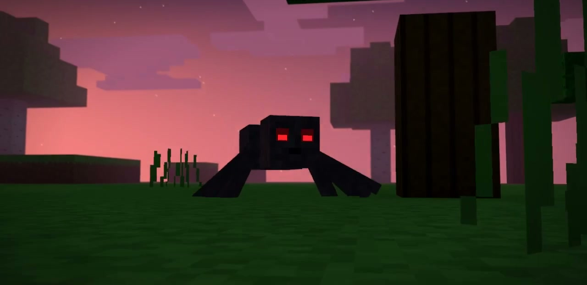</a>
</p>

<p align="center">
  <a href="https://viniciusnoetzold.github.io/mine-blockreel-skill-/#first-night"><b>▶ Watch Primeira Noite with sound (First Night, 60 seconds)</b></a> · <a href="https://viniciusnoetzold.github.io/mine-blockreel-skill-/#first-night-reel"><b>Watch the vertical 9:16 Reel</b></a><br>
  A player races the sunset, seals himself inside a hillside, and discovers what the torchlight was hiding.<br>
  <a href="examples/first-night/">Production files</a> · <a href="https://viniciusnoetzold.github.io/mine-blockreel-skill-/#aurora-express">▶ Watch Aurora Express (30 seconds)</a>
</p>

## Quick start

### Use the Claude Code plugin

```bash
claude plugin marketplace add ViniciusNoetzold/mine-blockreel-skill-
claude plugin install blockreel@blockreel-market
```

Start a Claude Code session and invoke `/blockreel:blockreel`. Try this prompt.

> Make a 30-second cinematic short about a courier crossing a collapsing ice bridge. Open with a clear visual hook, build to one decisive action, and end with a quiet payoff. Use original assets, score, and sound effects. Show me the brief and shot list, review the preview, and deliver the MP4 and editable project.

Try more genres in the [prompt cookbook](docs/PROMPTS.md).

<details>
<summary><b>Update an existing installation</b></summary>

```bash
claude plugin marketplace update blockreel-market
claude plugin update blockreel@blockreel-market
```

Start a new session to load the update. [Claude Code plugin updates](https://code.claude.com/docs/en/discover-plugins#keep-plugins-updated)

</details>

### Run the tools directly

Install **Node.js 20+**, **Python 3.11+**, and **FFmpeg**. Make sure `ffmpeg` and `ffprobe` are on your `PATH`. The renderer uses Chromium and can run with software graphics.

```bash
git clone https://github.com/ViniciusNoetzold/mine-blockreel-skill-
cd mine-blockreel-skill-
npm ci
python -m pip install -r requirements.txt
python -m playwright install chromium
python tools/render.py examples/hello-world/story.json --preset preview --out films/hello/preview.mp4
```

Open `films/hello/preview.mp4` for the first render. Set `CHROME_PATH` to point to an existing Chrome or Chromium installation if needed.

### Render Aurora Express

Run from the repository root after setup. The example uses original assets, a generated score, and timed effects for footsteps, rails, impacts, and the signal.

```bash
python examples/aurora-express/make_audio.py
python tools/qa.py examples/aurora-express/story.json --out films/aurora-express/qa --no-md
python tools/render.py examples/aurora-express/story.json --preset preview --out films/aurora-express/preview.mp4
```

Review `films/aurora-express/qa/contact-sheet.png` and play the preview with sound. Then render the full 1280 × 720, 24 fps film.

```bash
python tools/render.py examples/aurora-express/story.json --workers 2 --crf 20 --out films/aurora-express/film.mp4
python tools/check_media.py films/aurora-express/film.mp4 --duration 30 --size 1280x720 --fps 24 --require-audio
```

## Cinematic workflow

1. **Brief and shot list.** Set the runtime, story beats, visual style, and what each shot communicates. Prove expensive shots with test stills.
2. **Build the sequence.** Compile `plan.json` with `tools/compose.py` for automatic blocking, coverage, choreography, and audio cues. Edit `story.json` directly for bespoke sets, acting, and camera moves.
3. **Review picture and sound.** Run `tools/qa.py`, inspect the contact sheet for framing and continuity, and watch the preview with the mix. Fix issues at the source and rerun the affected checks.
4. **Finish and export.** Render the approved storyboard to MP4, then export the thumbnail, GIF, subtitles, or vertical version as needed.

For shot planning, render budgets, audio, and final checks, see the [cinematic production guide](docs/CINEMATIC-WORKFLOW.md).

<details>
<summary><b>Compile a film from a beat plan</b></summary>

Edit the [A Casa Nova plan](examples/creeper-surprise/plan.json) and compile it into a full storyboard.

```bash
python tools/compose.py examples/creeper-surprise/plan.json --out films/casa
python tools/qa.py films/casa/story.json --out films/casa/qa
python tools/render.py films/casa/story.json --preset preview --out films/casa/preview.mp4
```

</details>

## Film gallery

[Watch BlockReel films in the browser](https://viniciusnoetzold.github.io/mine-blockreel-skill-/). The players have native controls.

### Earlier demos

<table>
  <tr>
    <td width="50%" valign="top">
      <a href="https://viniciusnoetzold.github.io/mine-blockreel-skill-/#vila-viva">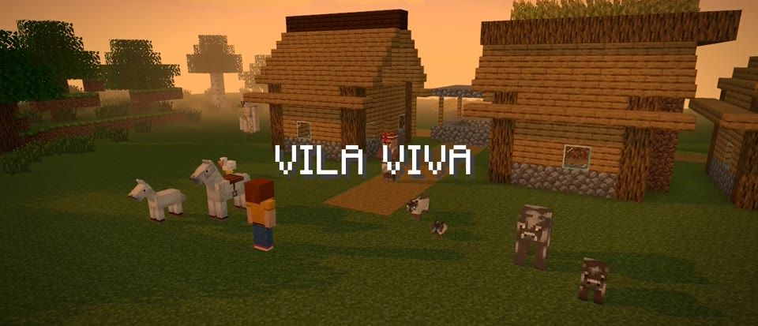</a><br>
      <b><a href="https://viniciusnoetzold.github.io/mine-blockreel-skill-/#vila-viva">▶ Vila Viva</a></b> · 28 s<br>
      A sunset village with families of mobs, a horse ride, and fireworks. <a href="examples/village-life/plan.json">Plan</a>
    </td>
    <td width="50%" valign="top">
      <a href="https://viniciusnoetzold.github.io/mine-blockreel-skill-/#herobrine">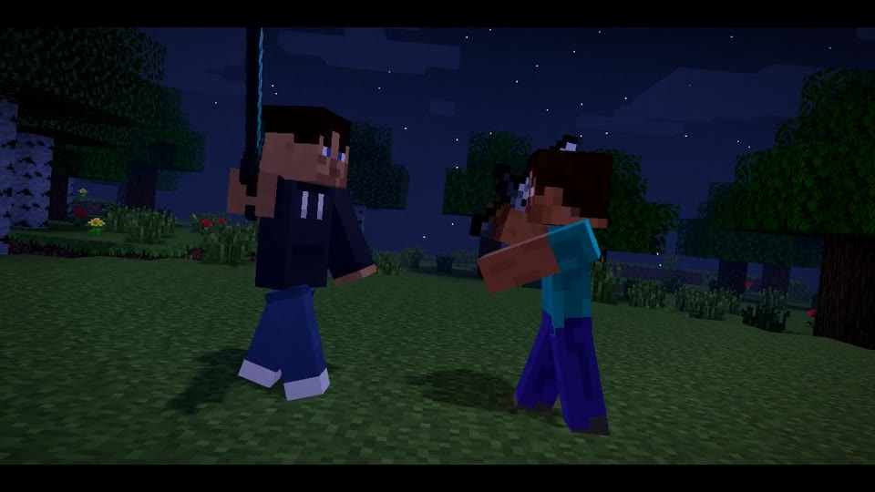</a><br>
      <b><a href="https://viniciusnoetzold.github.io/mine-blockreel-skill-/#herobrine">▶ Eu vs Herobrine</a></b> · 40 s<br>
      A custom persona faces Herobrine in a sword duel. <a href="examples/herobrine-duel/plan.json">Plan</a>
    </td>
  </tr>
  <tr>
    <td width="50%" valign="top">
      <a href="https://viniciusnoetzold.github.io/mine-blockreel-skill-/#creeper-surprise">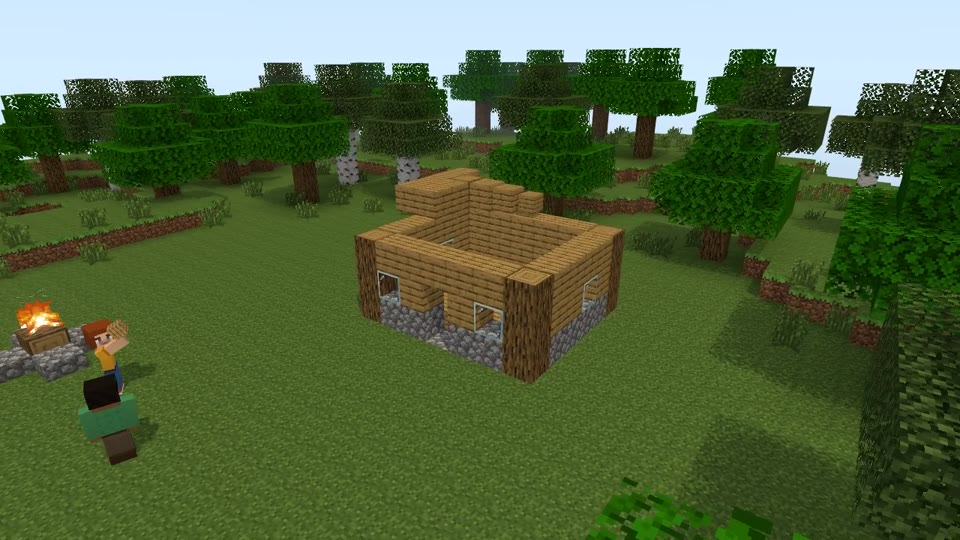</a><br>
      <b><a href="https://viniciusnoetzold.github.io/mine-blockreel-skill-/#creeper-surprise">▶ A Casa Nova</a></b> · 39 s<br>
      Two friends build a house. A creeper has other plans. <a href="examples/creeper-surprise/plan.json">Plan</a>
    </td>
    <td width="50%" valign="top">
      <a href="https://viniciusnoetzold.github.io/mine-blockreel-skill-/#zombie-night">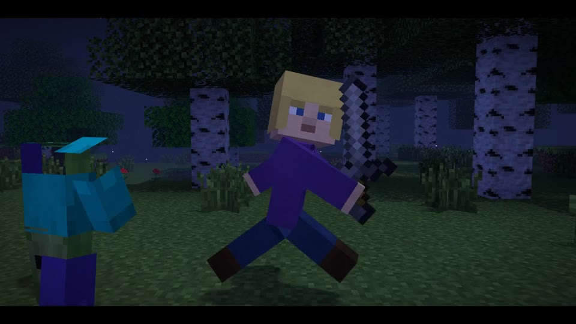</a><br>
      <b><a href="https://viniciusnoetzold.github.io/mine-blockreel-skill-/#zombie-night">▶ Primeira Noite (earlier demo)</a></b> · 31 s<br>
      A forest chase ends with a stone-sword fight. <a href="examples/zombie-night/plan.json">Plan</a>
    </td>
  </tr>
  <tr>
    <td width="50%" valign="top">
      <a href="https://viniciusnoetzold.github.io/mine-blockreel-skill-/#farol-negro">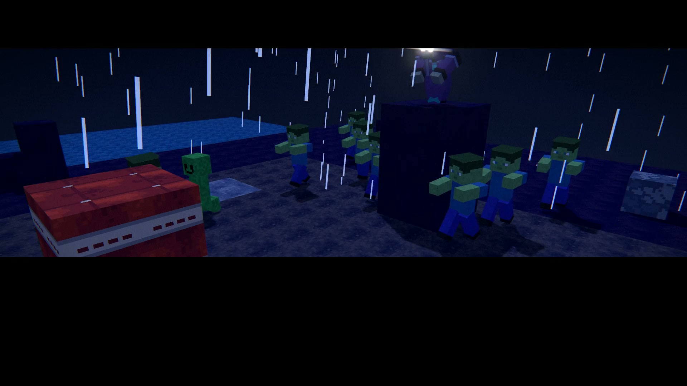</a><br>
      <b><a href="https://viniciusnoetzold.github.io/mine-blockreel-skill-/#farol-negro">▶ Farol Negro</a></b> · 22 s<br>
      A lone warrior defends a beacon from a horde.
    </td>
    <td width="50%" valign="top">
      <a href="https://viniciusnoetzold.github.io/mine-blockreel-skill-/#the-last-torch">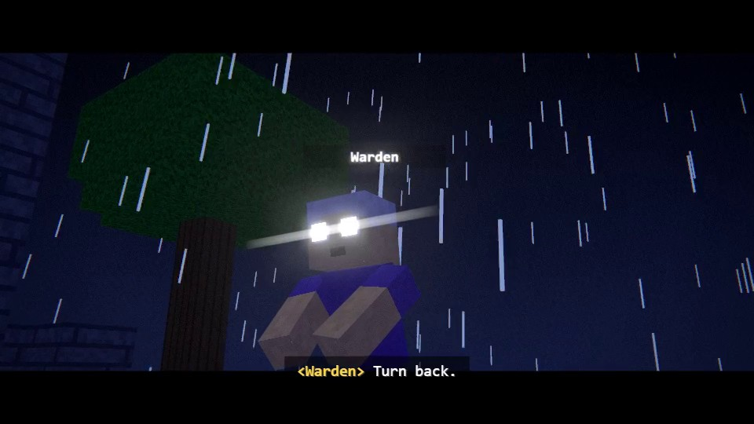</a><br>
      <b><a href="https://viniciusnoetzold.github.io/mine-blockreel-skill-/#the-last-torch">▶ The Last Torch</a></b> · 34 s (silent)<br>
      A cinematic short with its brief, shot list, and QA log. <a href="examples/last-torch">Production files</a>
    </td>
  </tr>
</table>

More formats include channel openings, building timelapses, quiet slice-of-life films, and dialogue episodes. [Genre guide](docs/GENRES.md)

## What you can direct

| Area | Capabilities |
| --- | --- |
| Worlds | Biomes, caves, generated villages, props, animated world changes, weather, and block lighting |
| Characters | Classic and slim skins, custom height, portable wolf rig, facial acting, and blended emotes. [Mob guide](docs/MOBS.md) |
| Equipment | Animated and swappable capes, shields, and custom mod sprites for held items. [Equipment guide](docs/EQUIPMENT.md) |
| Optional HUD | Event chat, hotbar, inventory, and staged recipes. [HUD guide](docs/HUD.md) |
| Camera and effects | Orbit, handheld, first person, rack focus, speed ramps, particles, and color grading |
| Sound | Original score, timed effects, optional offline voices, and dialogue ducking |
| Delivery | MP4, GIF, [Reels in 9:16](docs/REELS.md), SRT subtitles, and a thumbnail |

<details>
<summary><b>See frames from the engine</b></summary>

<p>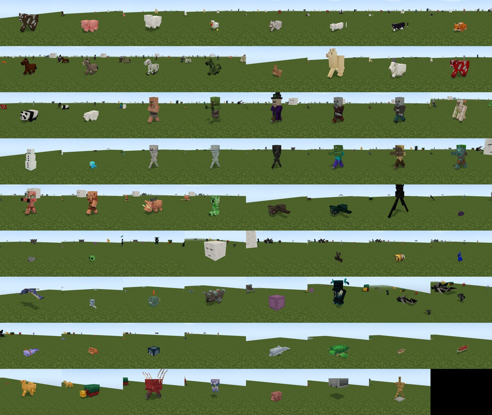<br><sub>Mob lineup with the optional game asset cache.</sub></p>
<p>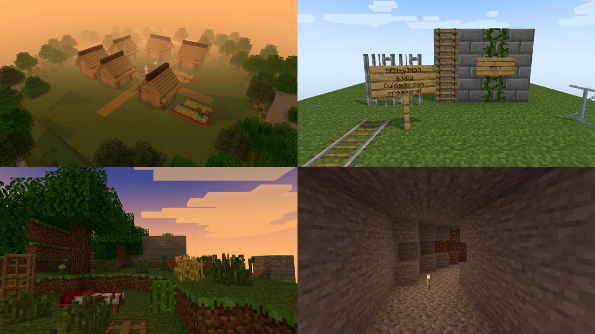<br><sub>Generated villages, props, and caves.</sub></p>
<p>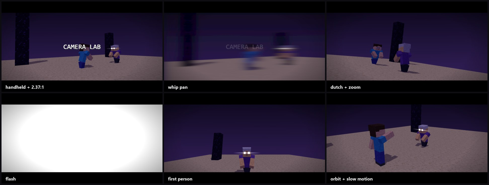<br><sub>Camera and transition tests.</sub></p>
<p>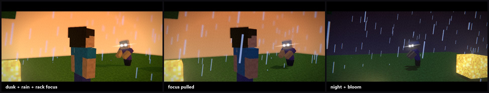<br><sub>Lighting and post-processing tests.</sub></p>

</details>

The engine currently has gaps in redstone, boats, and large crowds. Render time depends on scene complexity, resolution, and hardware. Use the preview preset or render one still with `--frame` to iterate on a shot. [Engine coverage](docs/COVERAGE.md)

### Three skills in one plugin

| Skill | Use it for |
| --- | --- |
| [`blockreel`](plugin/skills/blockreel/SKILL.md) | Directing an animated film from a prompt or reference, through the final mix and visual review |
| [`blockreel-skins`](plugin/skills/blockreel-skins/SKILL.md) | Painting and validating player skins with a four-angle turntable. [Skin example](examples/skin-demo) |
| [`blockreel-textures`](plugin/skills/blockreel-textures/SKILL.md) | Designing tileable block and item textures, previewing them in a scene, and packing a resource ZIP. [Texture example](examples/texture-pack-demo) |

## Project references

| Start here | What it covers |
| --- | --- |
| [Director plans](docs/DIRECTOR-PLAN.md) · [Storyboard schema](docs/STORYBOARD.md) | Beats for the compiler and fields for hand-directed scenes |
| [Direction](DIRECTOR.md) · [QA](docs/QA.md) · [Engine internals](TECHNIQUE.md) | Staging, performance, camera work, and verification |
| [Mobs](docs/MOBS.md) · [Skins](docs/SKINS.md) · [Resource packs](docs/RESOURCE-PACKS.md) | Models, character art, and block textures |
| [Asset policy](docs/LEGAL.md) | Built-in assets, local game cache, and third-party assets |

BlockReel is an independent fan project. It can render with its bundled CC0 textures and skins, and it runs without a Minecraft installation. To use the game's look and effects, `python tools/vanilla.py all` fetches assets into the gitignored local cache at `work/vanilla/`. [Asset policy](docs/LEGAL.md)

## Contribute

Share a film made with BlockReel, report a render issue with its smallest reproducible storyboard, or contribute a beat, animation, style, or documentation fix. [Open an issue](https://github.com/ViniciusNoetzold/mine-blockreel-skill-/issues/new) · [Engine coverage](docs/COVERAGE.md)

For code changes, run the Python suite and the engine checks.

```bash
python -m pip install pytest
python -m pytest tests -q
node tests/anim_check.mjs
node tests/world_check.mjs
node tests/geo_check.mjs
```

If you make something with BlockReel, star the repo so other creators can find it. [BlockReel on GitHub](https://github.com/ViniciusNoetzold/mine-blockreel-skill-)

## License

Code and documentation are released under [MIT](LICENSE). Bundled original textures and skins are CC0. Minecraft is a trademark of Mojang Synergies AB. [Asset policy](docs/LEGAL.md)
