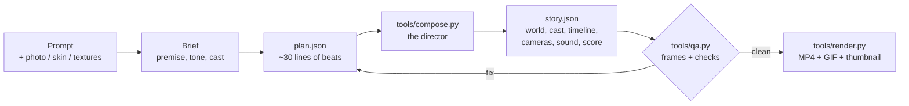

<p align="center"></p>

<h1 align="center">BlockReel</h1>

<p align="center"><b>Type a story. Get a Minecraft film.</b><br>
A Claude Code plugin that turns a prompt (and optionally your skin, your photo or your textures) into a finished animated video:
script, shot list, a blocky world, acting, camera work, sound effects, an original score, QA, MP4. No video model: every frame is drawn by code.</p>

<p align="center">
  <a href="https://github.com/ViniciusNoetzold/mine-blockreel-skill-/actions/workflows/ci.yml"></a>
  <a href="LICENSE"></a>
  
  
  
  
  
</p>

<p align="center">
  <a href="README.pt-BR.md">🇧🇷 Leia em português</a> ·
  <a href="#-films-made-with-blockreel">Films</a> ·
  <a href="#-from-a-prompt-to-a-film">How it works</a> ·
  <a href="#-features">Features</a> ·
  <a href="#-install">Install</a> ·
  <a href="#-quick-start">Quick start</a> ·
  <a href="docs/COVERAGE.md">What is missing</a>
</p>

<p align="center"><a href="docs/media/vila-viva.mp4"></a></p>
<p align="center"><a href="docs/media/vila-viva.mp4"><b>▶ Watch <i>Vila Viva</i> (28 s, with sound)</b></a> — a 40-line plan, compiled and rendered by BlockReel. Every mob moves with the game's own animations.</p>

> **Unofficial fan tool.** Not affiliated with Mojang or Microsoft. The repository ships **no game assets**: `tools/vanilla.py` downloads the
> original textures, models, animations and sounds from Mojang's own public sources into a gitignored cache on *your* machine
> ([docs/LEGAL.md](docs/LEGAL.md)). Without the cache, BlockReel uses its own CC0 textures.

---

## 🎬 Films made with BlockReel

Every film below was produced by the skill from a short plan. Click a picture to watch the MP4 (GitHub plays it in the browser).

<table>
  <tr>
    <td width="50%" valign="top">
      <a href="docs/media/vila-viva.mp4"></a><br>
      <b><a href="docs/media/vila-viva.mp4">▶ Vila Viva</a></b> · slice of life · 28 s<br>
      <sub>A generated village, a librarian and a farmer, a kid running, a cow and her calf, a Siamese cat and kitten, a ride on a white horse with
      its foal behind, fireworks at dusk. Shows: villages, babies, variants, riding, the game's mob animations.
      <a href="examples/village-life/plan.json">plan</a></sub>
    </td>
    <td width="50%" valign="top">
      <a href="docs/media/herobrine.mp4"></a><br>
      <b><a href="docs/media/herobrine.mp4">▶ Eu vs Herobrine</a></b> · action · 40 s<br>
      <sub>The hero is a persona painted from a description of a photo. Lightning reveal, dialogue, a sword duel with 180°-rule coverage,
      a teleport, a lightning power, a slow-motion finisher. <a href="examples/herobrine-duel/plan.json">plan</a></sub>
    </td>
  </tr>
  <tr>
    <td width="50%" valign="top">
      <a href="docs/media/creeper-surprise.mp4"></a><br>
      <b><a href="docs/media/creeper-surprise.mp4">▶ A Casa Nova</a></b> · comedy · 39 s<br>
      <sub>Two friends build a house in a timelapse; a creeper sneaks up; half the house is gone; "...de novo não."
      <a href="examples/creeper-surprise/plan.json">plan</a></sub>
    </td>
    <td width="50%" valign="top">
      <a href="docs/media/zombie-night.mp4"></a><br>
      <b><a href="docs/media/zombie-night.mp4">▶ Primeira Noite</a></b> · survival · 31 s<br>
      <sub>First night: a zombie appears, a chase through the forest, a stone-sword fight, victory under the stars.
      <a href="examples/zombie-night/plan.json">plan</a></sub>
    </td>
  </tr>
  <tr>
    <td width="50%" valign="top">
      <a href="docs/media/farol-negro.mp4"></a><br>
      <b><a href="docs/media/farol-negro.mp4">▶ Farol Negro</a></b> · cinematic · 22 s · 2.37:1<br>
      <sub>A warrior defends the last beacon against a horde. 18 shots, original skins and blocks, three lighting acts, voices, 3 QA rounds.</sub>
    </td>
    <td width="50%" valign="top">
      <a href="docs/media/the-last-torch.mp4"></a><br>
      <b><a href="docs/media/the-last-torch.mp4">▶ The Last Torch</a></b> · cinematic · 34 s<br>
      <sub>The first demo, made with the skill's full flow: <a href="examples/last-torch/brief.md">brief</a> →
      <a href="examples/last-torch/research.md">research</a> → <a href="examples/last-torch/shotlist.md">shot list</a> → <a href="examples/last-torch/qa.md">QA log</a>.</sub>
    </td>
  </tr>
</table>

Not only fights: comedy, survival, slice of life, building timelapses, mining trips, dialogue episodes, channel openings. See [docs/GENRES.md](docs/GENRES.md).

---

## 🧭 From a prompt to a film

```text
You:   "Faz um vídeo de Minecraft meu contra o Herobrine. Usa essa foto minha."
```



1. **Brief.** Claude fixes premise, tone, length and cast (your skin, a persona painted from your photo, or presets such as Herobrine).
2. **Plan.** It writes a short list of *beats*: `establish`, `walk`, `line`, `duel`, `build`, `ride`, `creeper`, `chase`, `ending`... ([docs/DIRECTOR-PLAN.md](docs/DIRECTOR-PLAN.md)).
3. **Direct.** `tools/compose.py` does the film-making arithmetic: blocking, fight choreography, 180°-rule coverage, over-the-shoulder dialogue,
   cuts on action, slow motion on decisive hits, footsteps and hits from the game's sounds, and an original score that follows the beats.
4. **Review.** `tools/qa.py` renders a contact sheet and checks every 0.05 s: an actor inside a wall, a camera inside a tree, a face turned away,
   cropped subjects, clipped subtitles, shots that run too long. Claude **looks** at the frames and fixes the plan.
5. **Render.** Headless Chrome draws each frame (`renderAt(t)` is a pure function of time), ffmpeg encodes, the audio is mixed with ducking.
   Exports: MP4, GIF, a vertical 9:16 re-render, SRT subtitles, a thumbnail with a title.

<details>
<summary><b>What a plan looks like</b> (the whole of <i>A Casa Nova</i>)</summary>

```json
{
 "title": "A Casa Nova", "size": [1280, 720], "style": "classic-2012",
 "world": {"biome": "plains", "arena": {"center": [0, 0], "radius": 13}, "structures": [{"structure": "campfire", "pos": [-6, null, 6]}]},
 "cast": {
  "lia":  {"persona": {"model": "slim", "hair": {"color": "#7a3a1a", "style": "ponytail"}, "top": {"type": "tshirt", "color": "#e0a030"}}},
  "beto": {"persona": {"hair": {"style": "curly"}, "glasses": {"style": "square"}, "top": {"type": "shirt", "pattern": "plaid"}}},
  "creeper": {"mob": "creeper", "hidden": true}
 },
 "beats": [
  {"beat": "establish", "dur": 3.5, "text": "A CASA NOVA"},
  {"beat": "line", "who": "lia", "to": "beto", "text": "Bora construir nossa casa aqui!", "emotion": "smile"},
  {"beat": "build", "who": "lia", "structure": "house", "at": [3, -4], "dur": 9},
  {"beat": "look", "who": "lia", "at": "creeper", "emotion": "scared"},
  {"beat": "creeper", "who": "creeper", "target": "beto", "radius": 3.5},
  {"beat": "line", "who": "beto", "to": "lia", "text": "...de novo não.", "emotion": "sad"},
  {"beat": "ending", "dur": 4.5, "text": "Fim?"}
 ]
}
```
`python tools/compose.py plan.json --out films/casa` → `story.json`, `music.wav`, `skins/`, `shotlist.md`. Abridged from
[examples/creeper-surprise/plan.json](examples/creeper-surprise/plan.json).
</details>

---

## ✨ Features

<table>
<tr><td width="50%" valign="top">

**🌍 A world drawn like the game draws it**
- chunk mesher with hidden-face culling: no z-fighting, no flicker, no see-through water
- the game's per-face shading, smooth-lighting ambient occlusion, **sky light and torch light propagated block by block**
- stairs, slabs, fences, walls, doors, trapdoors, ladders, vines, rails, panes, beds, crops, signs with text, torches, fire, flowing water and lava
- terrain with biomes, caves and ores, tunnels, **villages** on levelled ground (paths, houses facing the paths, farms, a well, lamps)
- structures never stand inside a tree; cameras never sit in a canopy
- sky dome, square sun and moon, stars, the game's cloud layer, lightning, rain and snow
- **millions of blocks**: 1.7 M blocks set up in 5 s, 0.7 s per 720p frame in software GL

</td><td width="50%" valign="top">

**🐄 Every mob, moving like the game**
- ~70 mobs with the game's own geometry and textures (`tools/vanilla.py mobs`)
- **the game's own animations**: a Molang interpreter evaluates each mob's animation scripts: horse gaits, bee wings, blaze rods, magma cube squash, villager arms...
- **babies** with the game's own baby models (calf, chick, pup, kitten, foal, kid villager...)
- **variants**: warm/cold cows, pigs and chickens, cat breeds, wolf coats, horse and llama colours, villager biomes and professions
- emissive mobs glow in the dark (blaze, magma cube, glow squid)
- riding (horse, camel, pig, minecart...), creepers that swell and blow up builds

</td></tr>
<tr><td valign="top">

**🧍 Characters and acting**
- your skin (classic/slim, 64x32 legacy, both layers) or a **persona painted from your photo**
- faces that blink, talk (lip-sync from text or from the audio), show emotion and wounds, glowing eyes
- 50+ clips with anticipation and follow-through: fights (slash, overhead, thrust, guard, dodge, knock-back), swim, crawl, climb, ride, eat, sleep, glide, build, mine...
- armour (8 materials, tinted leather), shield, cape, elytra, held swords, tools and bows extruded from item sprites

</td><td valign="top">

**🎥 Direction, camera, sound**
- a director compiler: beats → blocking, choreography, coverage, cuts, sound and score
- handheld, dutch, orbit, crane, first person, rack focus, whip pans, flashes, speed ramps, letterbox
- bloom, depth of field, grain, grade, motion blur
- the game's sound effects; an **original score** composed in code; offline voices; mix with ducking
- QA that catches the mistakes a viewer would see
- exports: MP4, GIF, vertical 9:16, SRT, thumbnails

</td></tr>
</table>

### Gallery

Each picture is a real render. Open a section:

<details open>
<summary><b>Mobs</b>: about 70 mobs with the game's own geometry, texture and animations</summary>

</details>

<details open>
<summary><b>Babies and variants</b>: the game's baby models; coats, breeds, biomes and professions (<code>"baby": true</code>, <code>"variant": "siamese"</code>)</summary>

</details>

<details>
<summary><b>Villages, caves and blocks</b>: villages on levelled ground, caves with ores, lit tunnels, doors, beds, signs with text, ladders, vines, rails, crops</summary>

</details>

<details>
<summary><b>Very large worlds</b>: millions of blocks, chunks past the fog are not drawn</summary>

</details>

<details>
<summary><b>Equipment and movement</b>: armour, shield, cape, elytra; ride, swim, crawl, climb, eat, drink, sleep, glide</summary>

</details>

<details>
<summary><b>Acting</b>: anticipation, overshoot and follow-through; crossfades between clips; heads that follow a target</summary>

</details>

<details>
<summary><b>Faces</b>: eyes, mouth and wounds over time on any skin; blinking; lip-sync; glowing eyes</summary>

</details>

<details>
<summary><b>Cameras and transitions</b>: handheld, dutch, zoom, first person, orbit, rack focus; flash, whip pan, fade; speed ramps; 2.37:1</summary>

</details>

<details>
<summary><b>Particles and world actions</b>: break, explosion, smoke, fire, sparks; crack stages, TNT with fuse, craters, doors, chests, water and lava</summary>


</details>

<details>
<summary><b>Look</b>: day-night lighting, rain and snow, bloom, depth of field, grain, colour grade</summary>

</details>

<details>
<summary><b>Celebrations and deliverables</b>: fireworks, totem, potion swirls; thumbnails with a title, vertical 9:16, GIF, SRT, motion blur</summary>

</details>

---

## 🧰 Three skills in one plugin

| Skill | What it does | Example |
|---|---|---|
| **`blockreel`** | Films. Brief → research (with links) → plan and shot list → build → **mandatory visual QA** → MP4 and deliverables. | [`examples/`](examples) |
| **`blockreel-skins`** | Player skins. Palette plan → layered painting in code → validation → **4-angle turntable** you iterate on. Classic and slim. A photo → a persona skin. | [`examples/skin-demo`](examples/skin-demo) |
| **`blockreel-textures`** | Block and item texture sets. One palette → tileable tiles → **seam and palette checker** → in-scene preview → resource-pack `.zip`. | [`examples/texture-pack-demo`](examples/texture-pack-demo) |

<table>
  <tr>
    <td width="50%"><br><sub>Skins: four review rounds of a demo skin, each fixing what the turntable showed</sub></td>
    <td width="50%"><br><sub>Textures: a 25-texture CC0 pack previewed in a scene, tiling checked</sub></td>
  </tr>
</table>

---

## 🚀 Install

**As a Claude Code plugin**

```bash
claude plugin marketplace add ViniciusNoetzold/mine-blockreel-skill-
claude plugin install blockreel@blockreel-market
```

**Or clone and run `claude` inside the folder**

```bash
git clone https://github.com/ViniciusNoetzold/mine-blockreel-skill- && cd mine-blockreel-skill-
npm install && pip install -r requirements.txt && python -m playwright install chromium
python tools/vanilla.py all       # optional: the game's textures, mobs, animations, sounds and font -> work/vanilla (local, never committed)
python -m pytest tests -q         # 60 tests + node checks
```

Needs Node 20+, Python 3.11+, ffmpeg and Chrome/Chromium (`CHROME_PATH=...` also works). No GPU needed.

## ⚡ Quick start

Ask Claude Code, in English or Portuguese:

| Prompt | What you get |
|---|---|
| *"Make a 30 s Minecraft video of me fighting Herobrine. Here is my photo."* | a persona skin from the photo, the duel film, a thumbnail and a GIF |
| *"Two friends build a house and a creeper blows it up."* | a comedy with a build timelapse and the explosion |
| *"A calm village morning: villagers, baby animals, a horse ride, fireworks at sunset."* | something like *Vila Viva* |
| *"An 8 s intro for my channel MEU CANAL, gold blocks, my skin waving."* | `tools/opening.py`: the name in blocks, a blast, an orbit, the logo hold |
| *"Design a hooded elf skin for me, slim arms."* | a skin with a 4-angle turntable |
| *"Make a 16x pastel texture pack."* | a tileable set, a preview and a resource-pack zip |

More, including a full "super production" brief: [docs/PROMPTS.md](docs/PROMPTS.md).

Or drive the tools yourself:

```bash
python tools/compose.py examples/village-life/plan.json --out films/vila          # plan -> story.json, music, skins, shot list
python tools/qa.py films/vila/story.json --out films/vila/qa                       # contact sheet + automatic checks
python tools/render.py films/vila/story.json --preset preview --workers 4 --out films/vila/preview.mp4
python tools/render.py films/vila/story.json --workers 4 --out films/vila/film.mp4
python tools/export.py gif films/vila/film.mp4 --start 4 --dur 6 --out vila.gif   # also: vertical, srt, thumbnail
python tools/preview.py examples/camera-lab/story.json                             # live preview with a time slider
```

<details>
<summary><b>All the tools</b></summary>

| Tool | Job |
|---|---|
| `tools/compose.py` | the director: `plan.json` → `story.json` with blocking, coverage, choreography, sound cues and score |
| `tools/render.py` | `story.json` → MP4 (stills, preview preset, `--workers`, `--motion-blur`, `--size`, audio mux) |
| `tools/qa.py` | spread frames, contact sheet, dense path check every 0.05 s, framing, subtitles, pacing |
| `tools/export.py` | GIF, vertical 9:16 re-render, SRT, thumbnail with a title |
| `tools/vanilla.py` | the game's textures, mobs (geometry, animations, babies, variants), equipment, font and sounds into a local cache |
| `tools/score.py` | an original score from a section list (calm, build, battle, silence, dawn) |
| `tools/voice.py` | offline character voices (Piper pt-BR, Windows OneCore) with presets |
| `tools/audio.py` | music + sfx + dialogue mix with ducking |
| `tools/opening.py` | a YouTube-style channel opening from a name |
| `core/persona.py` | a player skin painted from a described photo (hair styles, clothes, glasses, colours sampled from the photo) |
| `tools/turntable.py`, `core/skin.py` | skin preview from 4 angles; validate / convert / paint skins that also work in the game |
| `core/tilecheck.py`, `tools/pack_preview.py`, `core/pack.py` | texture set checks, in-scene preview, resource-pack zip |
</details>

---

## 🏗️ How it works

```
plan.json ─► compose.py ─► story.json ─► Three.js engine in headless Chrome ─► PNG frames ─► ffmpeg ─► film.mp4
                                │                    ▲                                              ▲
                                │       game cache (work/vanilla) or CC0 built-ins          score + sfx + voices
                                └─► qa.py: contact sheet + checks
```

Every frame is a pure function of time (`renderAt(t)`), so a still matches the final video exactly, previews and parallel workers agree
frame for frame, and a film re-renders identically. Engine details: [TECHNIQUE.md](TECHNIQUE.md). Direction craft: [DIRECTOR.md](DIRECTOR.md).

```
core/engine/   mesher (chunks, culling, AO, light), worldgen, anim, face, geo (mob models) + molang (mob animations), equip, particles, post, env
core/          persona / skin / atlas / pack / tilecheck tools, CC0 built-in textures
tools/         compose, render, qa, export, vanilla, score, voice, audio, opening, preview, turntable
styles/        classic-2012, golden-hour, nightfall, void-arena, ember-haze
plugin/        the Claude Code plugin: skills blockreel, blockreel-skins, blockreel-textures
examples/      the films' plans, the first demo with its full paper trail, one lab per feature
docs/          schema, director plan, mobs, coverage, QA, pre-production, skins, packs, legal
tests/         python tests (tools, director, renders) + node checks (mesher, light, worldgen, mob rigs, Molang)
```

| Doc | For |
|---|---|
| [docs/DIRECTOR-PLAN.md](docs/DIRECTOR-PLAN.md) | the plan format and every beat |
| [docs/STORYBOARD.md](docs/STORYBOARD.md) | the full `story.json` schema |
| [docs/MOBS.md](docs/MOBS.md) | mobs, babies, variants, animations |
| [docs/COVERAGE.md](docs/COVERAGE.md) | what can and cannot be animated yet |
| [docs/PROMPTS.md](docs/PROMPTS.md) · [docs/GENRES.md](docs/GENRES.md) | ready-made prompts, genres |
| [docs/QA.md](docs/QA.md) · [docs/PREPRODUCTION.md](docs/PREPRODUCTION.md) | review and pre-production rules |
| [docs/SKINS.md](docs/SKINS.md) · [docs/RESOURCE-PACKS.md](docs/RESOURCE-PACKS.md) | skins and texture packs |
| [docs/LEGAL.md](docs/LEGAL.md) | what is shipped and what is fetched |

## ⏱️ Performance (measured, software GL, no GPU)

| Job | Time |
|---|---|
| one still, including browser start | ~3.5 s |
| 30 s film at 720p, 4 workers, 4 cores | ~10 min |
| 1.7 M-block world | 5 s setup, 0.7 s per 720p frame |
| 4.4 M-block world | 13 s setup, 0.6 s per frame (fog culls far chunks) |

`--preset preview` renders at a lower resolution for fast checks. `--gpu` exists but is untested.

## 🧱 Honest limits

The goal is *any* Minecraft animation; it is not there yet. [docs/COVERAGE.md](docs/COVERAGE.md) is the gap list, kept honest:

- **Missing:** redstone (pistons, levers, lamps), boats, overhangs and cliffs, crowd instancing (hundreds of actors), shader-pack reflections, inverse kinematics and cloth.
- The wolf, polar bear and ender dragon use bone-name animation rules instead of the game's scripts (their scripts drive an older rig).
- Skins and texture packs are validated and previewed in the BlockReel engine, not tested inside the real game.
- Software rendering is slow for long films: plan on minutes per 30 s.

## 🗺️ Roadmap

- **Done in v0.3:** the game's mob animations (Molang), babies and variants, villages, caves, doors, beds, signs, armour and elytra,
  riding, swimming and gliding, fireworks and totems, motion blur, vertical exports, audio lip-sync, very large worlds.
- **Next:** redstone, boats, cliffs and overhangs → crowd instancing → GPU rendering → a web UI for non-coders.

See [docs/GOOD-FIRST-ISSUES.md](docs/GOOD-FIRST-ISSUES.md) to help.

## ❓ FAQ

<details><summary><b>Do I need Minecraft installed?</b></summary>
No. With the cache (<code>python tools/vanilla.py all</code>) BlockReel downloads the game's textures, models and sounds from Mojang's public
sources to your machine; without it, it uses its own CC0 textures and rigs.</details>

<details><summary><b>Does it use an AI video model?</b></summary>
No. Claude writes the plan and reviews frames; the pictures are drawn by Three.js and encoded by ffmpeg. The output is deterministic and editable:
change a line of the plan and re-render.</details>

<details><summary><b>Can I use my own skin, a photo of me, or my texture pack?</b></summary>
Yes: a skin PNG (<code>"skin": "me.png"</code>), a persona painted from your photo (the skill reads the photo and samples its colours), and your
own block textures (<code>"textures"</code> / <code>"blocks"</code> in the story, or the <code>blockreel-textures</code> skill).</details>

<details><summary><b>Can I post the videos on YouTube?</b></summary>
Read Mojang's usage guidelines and <a href="docs/LEGAL.md">docs/LEGAL.md</a>. BlockReel never redistributes game assets; what you render with your local cache is your responsibility.</details>

<details><summary><b>Which languages?</b></summary>
Prompts in English or Portuguese (or anything Claude understands). Subtitles use the game's font, accents included. Offline voices ship for pt-BR.</details>

## 🤝 Contributing

Add a beat, a clip, a mob fix, a style or a doc fix. Run `python -m pytest tests -q` (and `node tests/world_check.mjs`, `node tests/geo_check.mjs`)
first. Never commit game assets. Pre-production and QA rules: [docs/PREPRODUCTION.md](docs/PREPRODUCTION.md), [docs/QA.md](docs/QA.md).

If BlockReel made you a film you like, a ⭐ helps other people find it.

## 📄 License

MIT for code and docs. Built-in textures, skins, sample mob textures and every example asset: CC0. Minecraft is a trademark of Mojang
Synergies AB; this project is not affiliated with Mojang or Microsoft.
