<p align="center">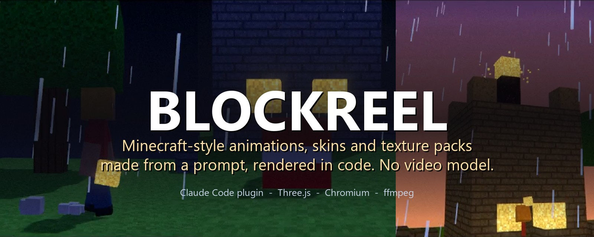</p>

<p align="center">
  <a href="https://github.com/ViniciusNoetzold/mine-blockreel-skill-/actions/workflows/ci.yml"></a>
  <a href="LICENSE"></a>
  
  
  
  
</p>

<p align="center"><b>Describe a story. Claude briefs it, researches references, writes a shot list, builds the blocky world, animates it, scores it, reviews its own frames and renders an MP4.</b><br>
Cinematic shorts, YouTube channel openings, dialogue episodes, about anything. It looks and sounds like the game by default (original textures and sound
effects, fetched to your own machine), uses <i>your</i> skins when you send them, and needs no video model: every frame is drawn by Three.js in headless
Chrome and encoded by ffmpeg.</p>

<p align="center"><a href="README.pt-BR.md">Leia em português</a> · <a href="#-install">Install</a> · <a href="#-the-three-skills">Skills</a> · <a href="docs/PROMPTS.md">Prompts</a> · <a href="docs/COVERAGE.md">What is missing</a> · <a href="docs/STORYBOARD.md">Schema</a></p>

> Unofficial fan tool. Not affiliated with Mojang or Microsoft. The repo ships **no** game assets: `tools/vanilla.py` downloads the original
> textures and sounds from Mojang's own sources into a gitignored cache on your machine (see [docs/LEGAL.md](docs/LEGAL.md)).

### What you can ask for

| Genre ([docs/GENRES.md](docs/GENRES.md)) | Example prompt | What you get |
|---|---|---|
| 🎬 **Cinematic short** | *"30 s epic: a warrior defends the last beacon against a zombie horde, TNT trap, dawn."* | brief, web research with links, shot list, skins, the film, QA report, key stills, a GIF |
| 📺 **Channel opening** | *"An 8 s intro for my channel MEU CANAL, gold blocks, a blast, my skin waving."* | `tools/opening.py` builds the name from blocks, blast, orbit, logo hold, game sounds + original music |
| 💬 **Series episode** | *"2 min comedy: Steve and Alex try to tame a creeper, use my two skins."* | singles for every line, voices (your recordings or offline TTS), lip-sync, chat-style subtitles |

### Sound is part of the film

Original game sound effects (explosions, doors, chests, mobs, hits, steps, rain, fire) from `tools/vanilla.py sounds`, an **original score** composed in
code that follows the film's energy (`tools/score.py`: calm → build → battle → silence → dawn), and **character voices** offline
(`tools/voice.py`: Piper neural pt-BR voices or Windows OneCore voices, presets hero / villain / monster / child / narrator / radio), mixed with ducking.

---

## See it

### New in v0.2: *Eu vs Herobrine* — one prompt, one plan, one film

<p align="center">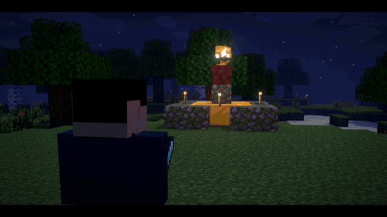</p>

<p align="center"><a href="docs/media/herobrine.mp4"><b>▶ Watch the 40 s film: <i>Eu vs Herobrine</i></b></a> (mp4, with the game's sound effects and an original score)</p>

<table>
  <tr>
    <td>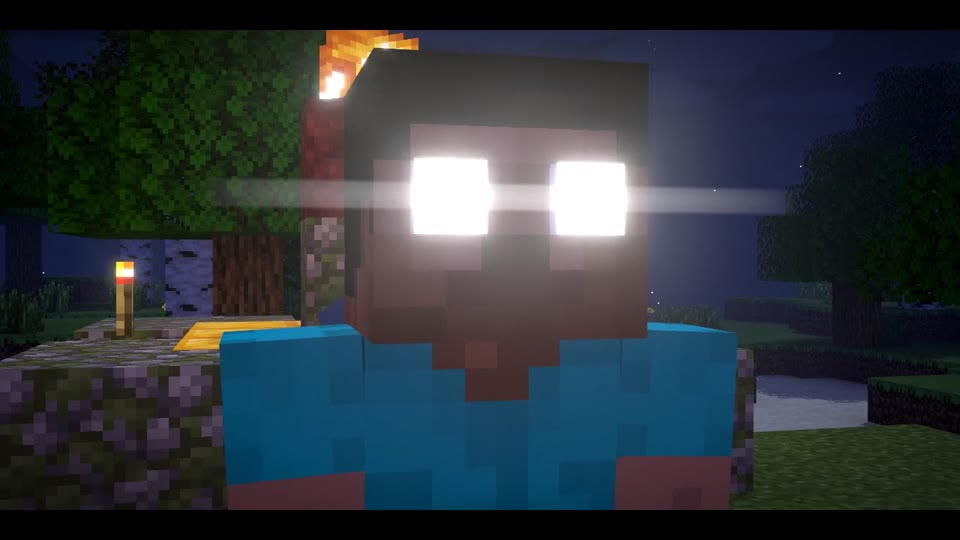</td>
    <td></td>
  </tr>
  <tr>
    <td>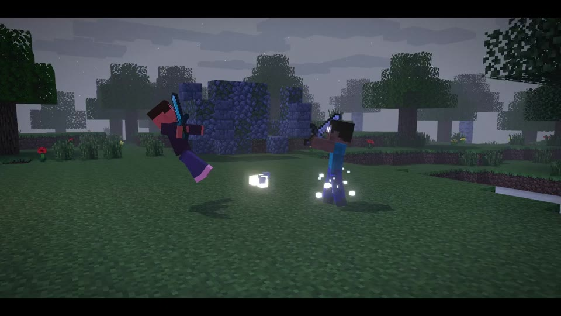</td>
    <td>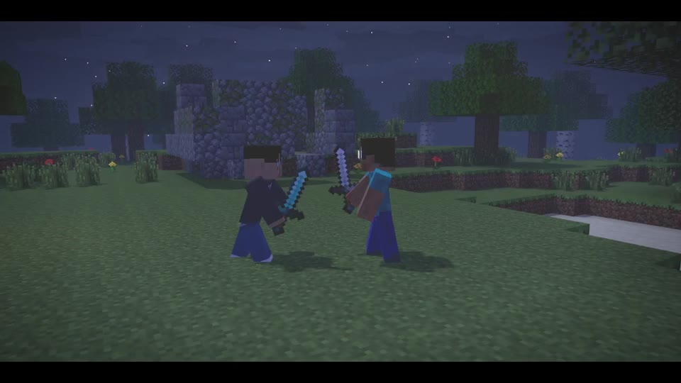</td>
  </tr>
</table>

The whole film is the 30-line plan in [`examples/herobrine-duel/plan.json`](examples/herobrine-duel/plan.json), compiled by
`tools/compose.py` ([the director](docs/DIRECTOR-PLAN.md)): blocking, fight choreography, 180°-rule coverage, slow motion on the
decisive hits, footsteps, sword, shield and thunder sounds from the game, and a score that goes calm → build → battle → silence → dawn.
The hero is a **persona painted from a description of a photo** (`core/persona.py`); Herobrine is a preset.

**Not only fights.** The same director makes any kind of Minecraft animation. Two more films from the shipped plans:

<table>
  <tr>
    <td width="50%">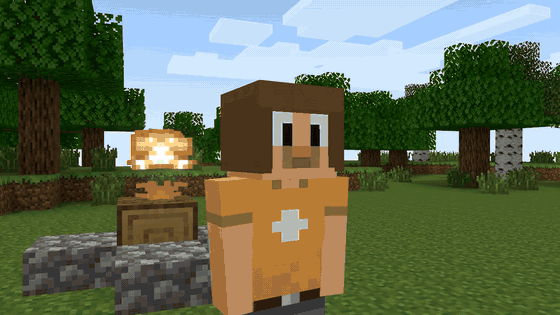<br>
      <a href="docs/media/creeper-surprise.mp4"><b>▶ <i>A Casa Nova</i></b></a> — comedy: a house built in a timelapse, then a creeper
      (<a href="examples/creeper-surprise/plan.json">plan</a>)</td>
    <td width="50%"><br>
      <a href="docs/media/zombie-night.mp4"><b>▶ <i>Primeira Noite</i></b></a> — survival: a zombie chase through the forest and a stone-sword fight
      (<a href="examples/zombie-night/plan.json">plan</a>)</td>
  </tr>
  <tr>
    <td></td>
    <td>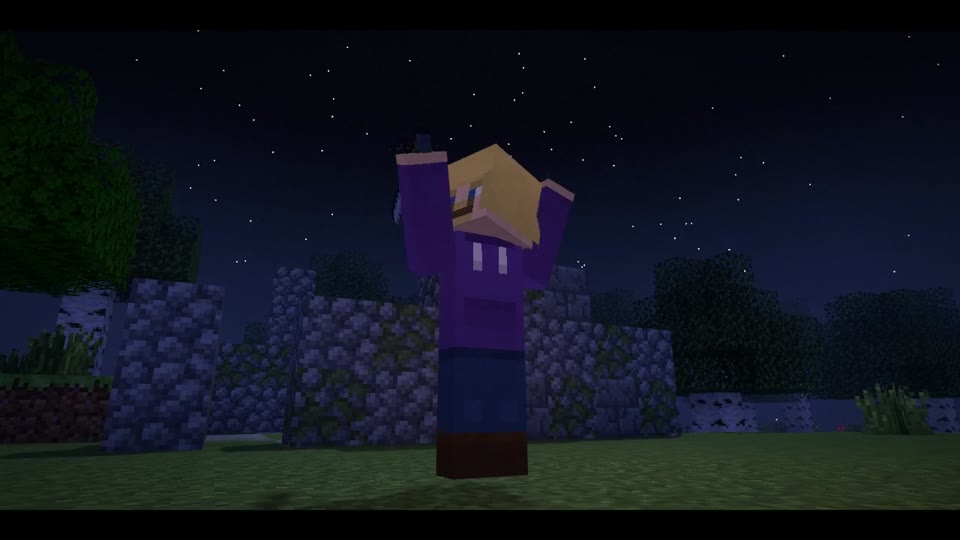</td>
  </tr>
</table>

Beats for building (`build` timelapses), mining, creepers, mob chases, dialogue, calm moods and fights: [docs/DIRECTOR-PLAN.md](docs/DIRECTOR-PLAN.md).

What makes it look like the game (v0.2):

- **The world is drawn like the game draws chunks**: hidden faces culled (no z-fighting, no flicker, no see-through water), the game's
  per-face shading, smooth-lighting ambient occlusion, **sky light and torch light propagated block by block** (caves are dark, torches
  light the night warmly), alpha-aware mip-maps so distant blocks never shimmer.
- **Stairs, slabs, fences, walls, torches, flowers, tall grass, fire**; terrain with biomes, an arena, water, oak/birch/spruce trees and
  buildings (house, tower, ruins, shrine) that **always stand on clear, levelled ground** — no house inside a tree.
- **Sky**: square sun and moon, stars, the game's cloud layer, lightning that lights the scene.
- **Held swords, tools and bows** extruded from the item sprites; combat clips (slash, overhead, thrust, guard, dodge, knock-back with a
  hop, fall, get up, cast, summon, levitate); the red damage flash and the white death poof.
- **The game's own font** for name tags, chat subtitles (accents included) and titles.


<p align="center">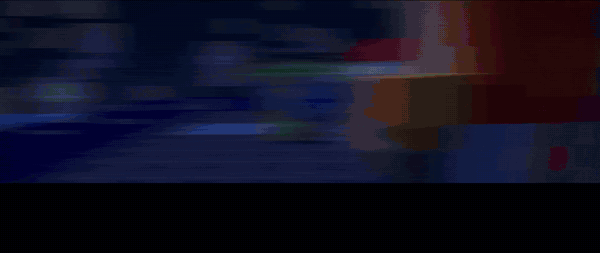</p>

<p align="center">
  <a href="docs/media/farol-negro.mp4"><b>▶ Watch the 30 s film: <i>Farol Negro</i></b></a> (3 MB mp4, 2.37:1, with the original score and voices)
</p>

<table>
  <tr>
    <td>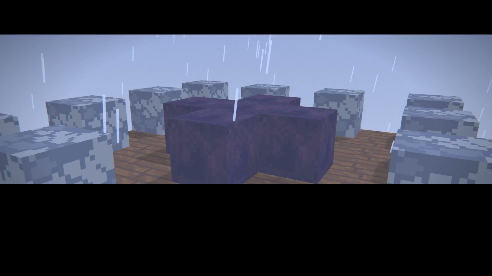</td>
    <td></td>
  </tr>
  <tr>
    <td>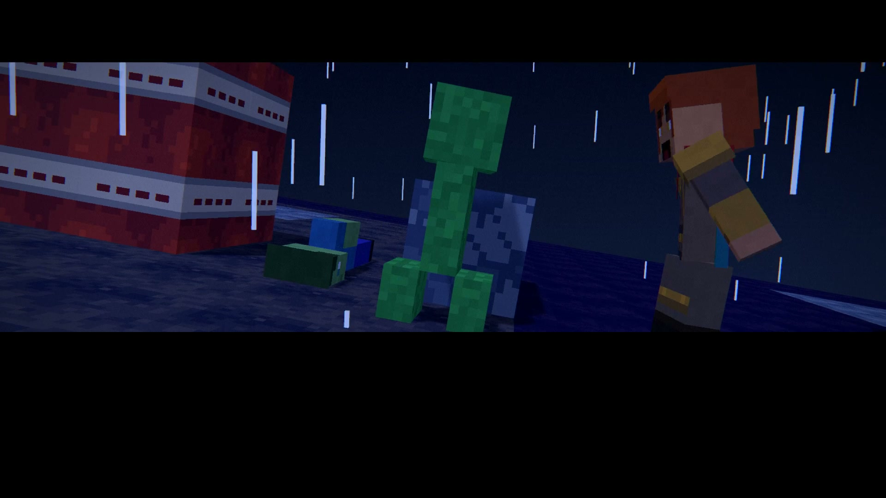</td>
    <td>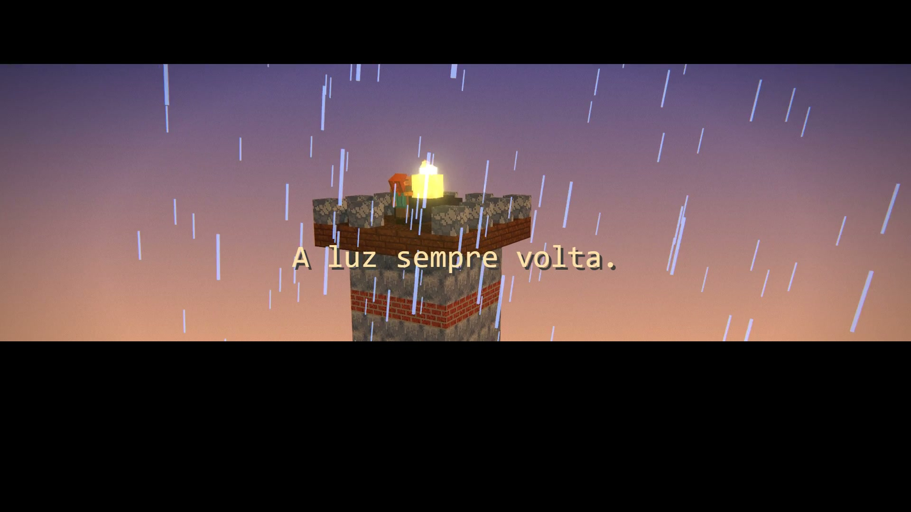</td>
  </tr>
</table>

<sub><i>Farol Negro</i> is a 30 s, 1920x1080 cinematic short produced end to end by the skill: briefing, web research, shot list,
two original skins painted and reviewed in 3 turntable rounds, a custom 13-texture block set, 18 shots with handheld, dutch, orbit,
first-person, rack focus and slow motion, three lighting acts, 3 QA rounds (0 FAIL), a 22 min software render with 4 workers, and a
sound mix built from the original game sound effects (fetched locally, not in this repo), an original score composed in code
(`tools/score.py`), synthesised whooshes and TTS voices. The repo copy keeps the score, voices and whooshes but leaves the game's
sound effects out, so that no game sound is redistributed.</sub>

The earlier demo, <a href="docs/media/the-last-torch.mp4"><i>The Last Torch</i></a> (34 s), lives in [`examples/last-torch`](examples/last-torch):

<table>
  <tr>
    <td>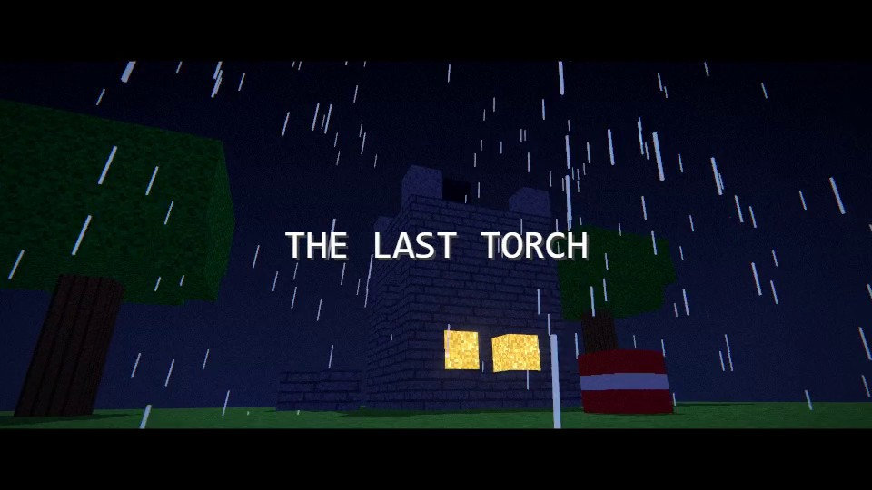</td>
    <td></td>
  </tr>
  <tr>
    <td>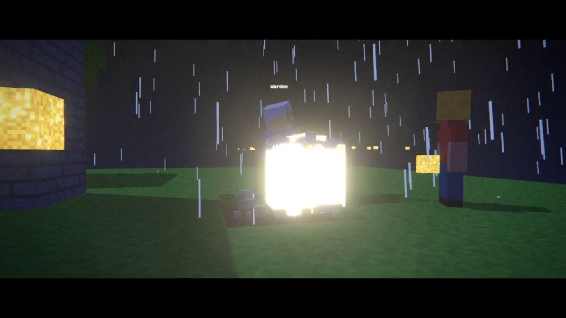</td>
    <td>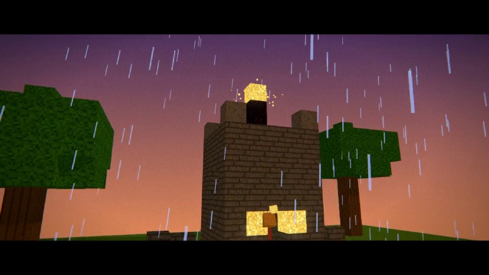</td>
  </tr>
</table>

<sub><i>The Last Torch</i> ([`examples/last-torch`](examples/last-torch)) is an original 34 s short made **with the skill itself**, following its own flow:
[brief](examples/last-torch/brief.md) → [web research with links](examples/last-torch/research.md) → [shot list](examples/last-torch/shotlist.md) → build → [QA log](examples/last-torch/qa.md) (three review rounds that caught a hidden beacon, a character floating over a crater and cropped feet).
960x540, 30 fps, post-processing on, rendered in 7.5 minutes with 4 workers. No game assets are used.</sub>

---

## 🧰 The three skills

| Skill | What it does | Proof |
|---|---|---|
| **`blockreel`** | Films. **Briefing → web research (with links) → script and shot list → build → mandatory visual QA → MP4.** | [`examples/last-torch`](examples/last-torch) |
| **`blockreel-skins`** | Player skins. Research → palette plan (4-tone ramps) → layered painting in code → validate → **4-angle turntable** you iterate on. Classic and slim. | [`examples/skin-demo`](examples/skin-demo) |
| **`blockreel-textures`** | Block/item texture sets. One palette for the whole set → tileable tiles → **seam and palette checker** → **in-scene preview** → resource-pack `.zip` with a researched, cited pack format. | [`examples/texture-pack-demo`](examples/texture-pack-demo) |

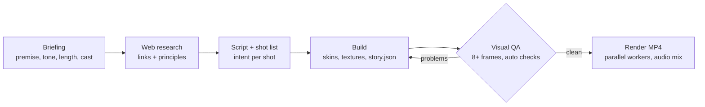

---

## 🎬 What the engine can do

Each picture below is a real render from the matching `examples/*-lab` storyboard (regenerate them with `python tools/make_media.py`).

**Acting that feels alive.** Clips with anticipation, overshoot and follow-through, crossfades between clips, shortest-arc turning, and heads that follow a target.
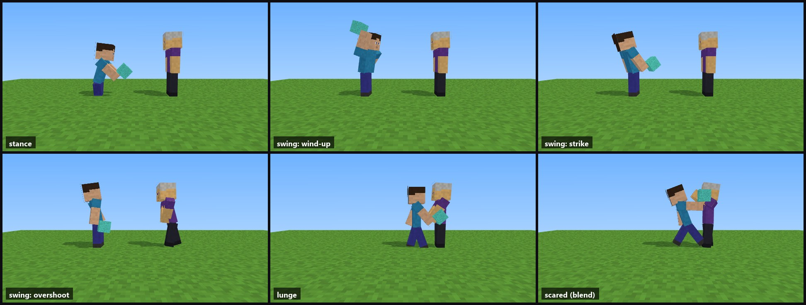

**Faces.** Eyes, mouth and wounds change over time on any skin; blinking is automatic; the mouth follows the subtitle text; glowing eyes with a light streak.
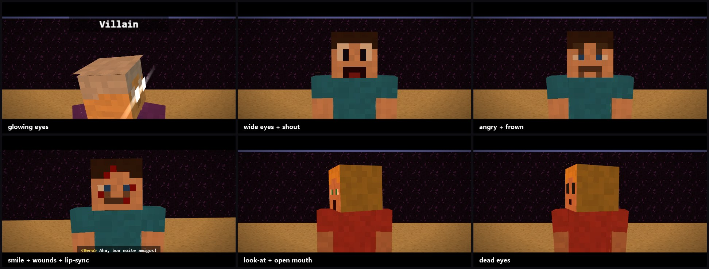

<details open>
<summary><b>Cameras and transitions</b>: handheld, Dutch, zoom, first person, orbit, rack focus; flash, whip pan, fade; speed ramps; 2.37:1 letterbox</summary>

</details>

<details>
<summary><b>Particles</b>: seeded cube particles (break, explosion, smoke, fire, sparks, dust, blood, confetti), deterministic frame by frame</summary>
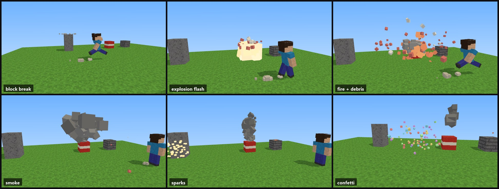
</details>

<details>
<summary><b>World actions</b>: crack stages, place, TNT with fuse, explosions that dig craters, doors, chests, flowing water and lava</summary>
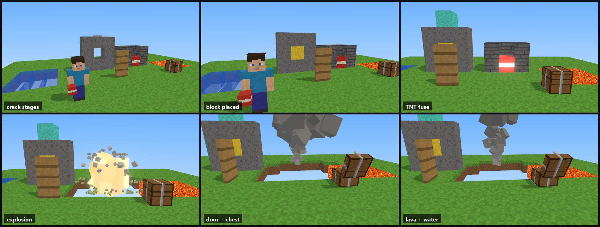
</details>

<details>
<summary><b>Look</b>: day-night lighting, rain and snow, bloom, depth of field, grain, colour grade</summary>

</details>

<details>
<summary><b>Mobs</b>: box rigs for creeper-, pig-, spider-shaped mobs (your textures) and zombies through the player rig</summary>
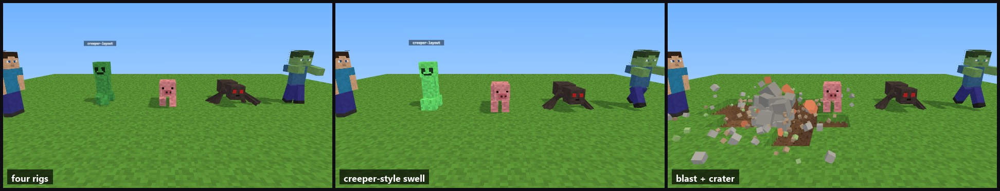
</details>

Also: music, sound effects and dialogue with ducking ([`tools/audio.py`](tools/audio.py)), parallel rendering, 1080p60, a live browser preview with a time slider, and a QA tool that renders a contact sheet and flags a camera inside a block, a character out of frame, a face turned away, clipped subtitles and shots that run too long.

---

## 🧍 Skins

`blockreel-skins` paints a skin the way a pixel artist would, then forces a look at the result from four angles. Four review rounds of the demo skin, with what was wrong each time:

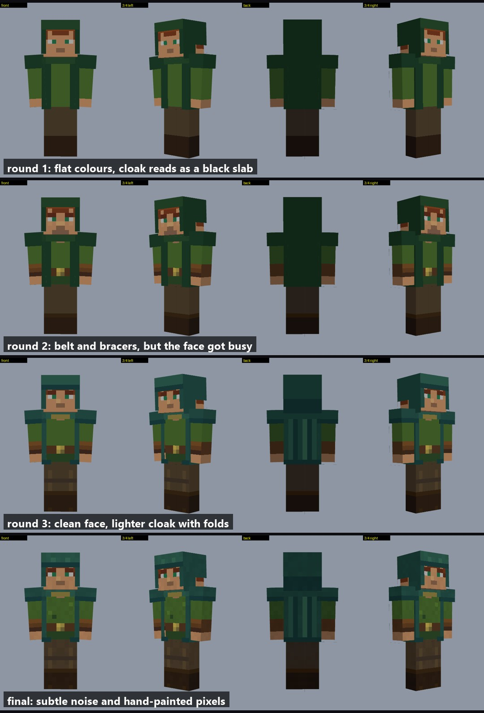

Slim variant, in a `wave` pose to check the arm joint and the mantle: 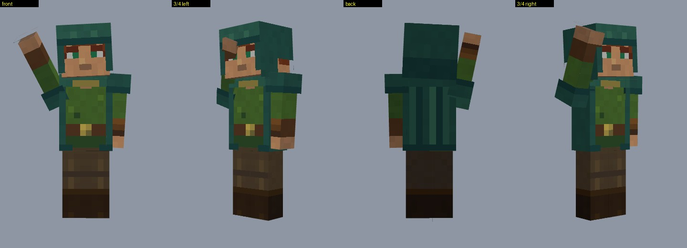

```bash
python tools/turntable.py skin.png --out tt.png --pose wave --model slim
python core/skin.py validate skin.png        # classic/slim, 0 transparent base pixels
```

## 🧱 Texture packs

`blockreel-textures` builds a coherent set, checks that it tiles, shows it in a scene next to a character, and builds the pack with a number it **looked up**, not guessed.

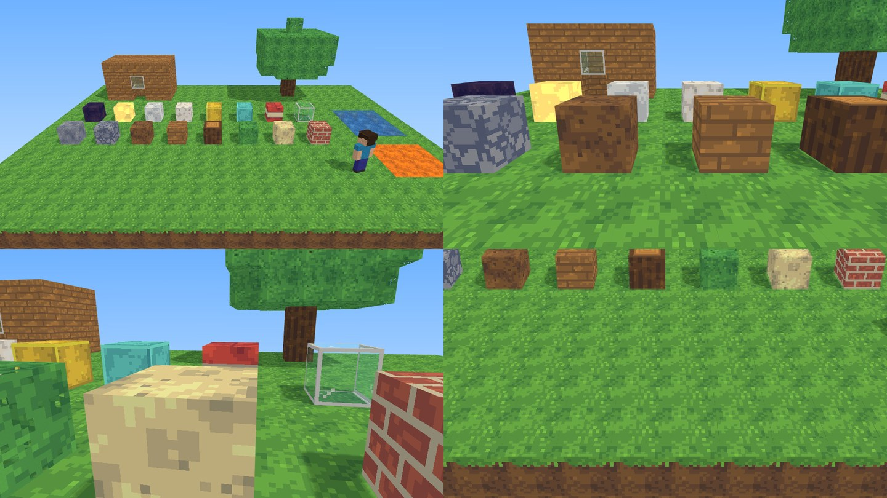

<table>
  <tr>
    <td width="50%">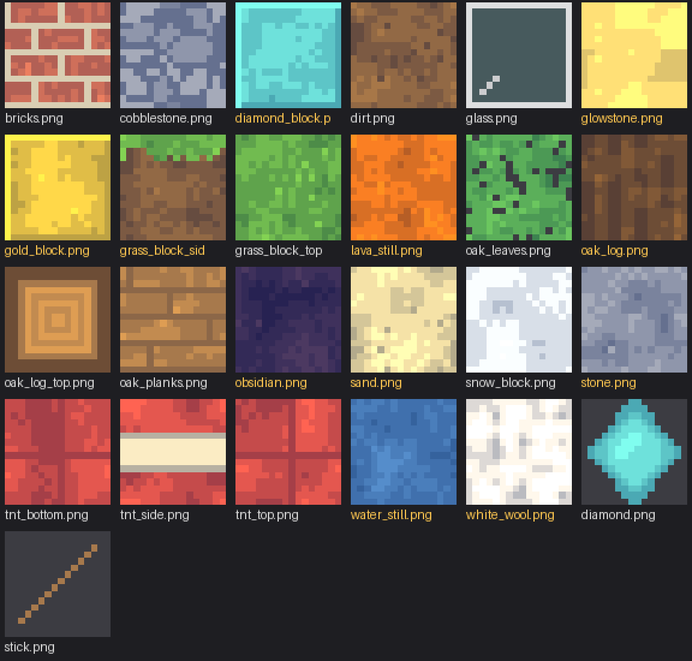</td>
    <td width="50%">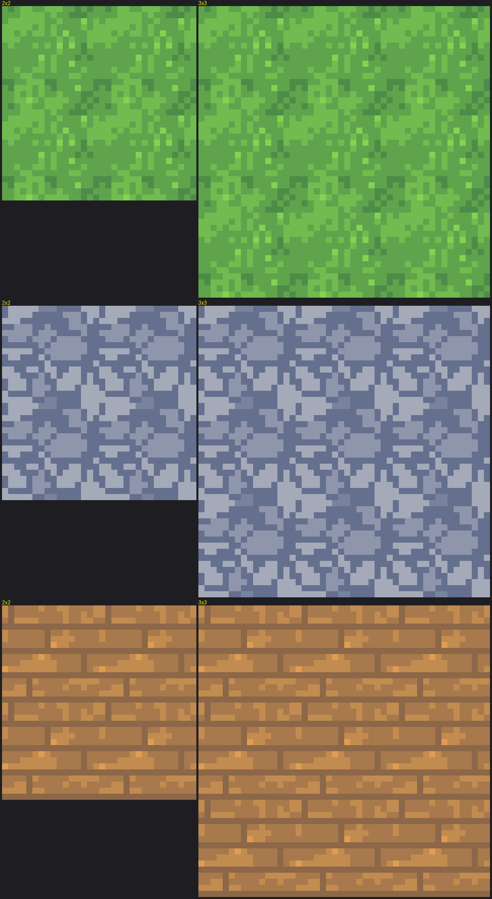</td>
  </tr>
  <tr><td align="center"><sub>25 original 16x textures (CC0), animated water and lava included</sub></td><td align="center"><sub>tiling previews: no visible seams</sub></td></tr>
</table>

```bash
python core/tilecheck.py set textures/ --out report/          # seams, palette, sizes + contact sheet
python tools/pack_preview.py textures/ --out preview.png      # the set in a scene
python core/pack.py build textures/ --name "My Pack" --pack-format 46 --format-version 1.21.4 \
  --format-source https://minecraft.wiki/w/Pack_format --out build/
```

---

## 🚀 Install

As a Claude Code plugin:

```bash
claude plugin marketplace add ViniciusNoetzold/mine-blockreel-skill-
claude plugin install blockreel@blockreel-market
```

Or clone it and run `claude` inside the folder:

```bash
git clone https://github.com/ViniciusNoetzold/mine-blockreel-skill- && cd mine-blockreel-skill-
npm install && pip install -r requirements.txt && python -m playwright install chromium
python -m pytest tests -q
```
Needs Node 20+, Python 3.11+, ffmpeg and Chrome/Chromium (`CHROME_PATH=...` also works).

Then ask, for example: *"Make a 30-second blocky animation about a noob who finds a diamond and a creeper-looking tree."*,
*"Design a hooded elf skin for me, slim arms."*, or *"Make a 16x pastel texture pack."* Ready-made, detailed prompts (including a 30 s "super production"): [docs/PROMPTS.md](docs/PROMPTS.md).

## ⚡ Try it

```bash
python tools/render.py examples/hello-world/story.json --frame 4 --out check.png               # one frame
python tools/render.py examples/last-torch/story.json --preset preview --out preview.mp4       # fast preview
python tools/render.py examples/last-torch/story.json --workers 4 --out film.mp4               # 4 parallel Chrome workers
python tools/preview.py examples/camera-lab/story.json                                          # live preview with a time slider
python tools/qa.py examples/last-torch/story.json --out out/qa                                  # quality review frames + checks
```

Look and sound like the game, and the production tools:

```bash
python tools/vanilla.py fetch          # original block, mob, chest and Steve/Alex textures -> work/vanilla (local, ~45 KB)
python tools/vanilla.py sounds         # original sound effects -> work/vanilla/sounds (local, ~1 MB, no music)
python tools/voice.py fetch            # offline neural voices (Piper pt-BR, CC0 datasets) -> work/voices
python tools/opening.py "MEU CANAL" --out films/intro && python tools/render.py films/intro/story.json --out films/intro/opening.mp4
python tools/score.py --out music.wav --duration 30 --sections calm:0:7,build:7:15,battle:15:23,silence:23:26,dawn:26:30
python tools/voice.py say "O farol cai esta noite." --voice piper:faber --preset villain --rate=-35% --out vigia.wav
```

| Tool | Job |
|---|---|
| `tools/render.py` | story.json → MP4 (stills, preview preset, `--scale`, `--workers`, audio mux) |
| `tools/qa.py` | spread frames + contact sheet + checks: camera/actor inside blocks, **dense path check every 0.05 s**, framing, subtitles, pacing |
| `tools/vanilla.py` | original textures and sound effects into a local cache (never committed) |
| `tools/opening.py` | YouTube-style channel opening from a name |
| `tools/score.py` | original background score that follows the energy shape |
| `tools/voice.py` | offline character voices with presets, trimmed to start on cue |
| `tools/audio.py` | music + sfx + dialogue mix with ducking |
| `tools/turntable.py`, `core/skin.py` | skin preview from 4 angles; validate / convert / paint skins that also work in the real game |
| `core/tilecheck.py`, `tools/pack_preview.py`, `core/pack.py` | texture set checks, in-scene preview, resource-pack zip |

## How it works

```
story.json ─► Three.js engine ─► headless Chrome ─► PNG frames ─► ffmpeg ─► film.mp4
                    ▲                                                  ▲
        skins, textures, styles                              tools/audio.py mix
```
Every frame is a pure function of time (`renderAt(t)`), so a still matches the final video exactly, and previews and parallel workers agree frame for frame.
Details in [TECHNIQUE.md](TECHNIQUE.md), direction craft in [DIRECTOR.md](DIRECTOR.md), the schema in [docs/STORYBOARD.md](docs/STORYBOARD.md).

```
core/        engine (anim, face, particles, world, mobs, post, env), skin / atlas / pack / tilecheck tools, original built-in textures
tools/       render, qa, audio, preview, turntable, pack_preview, make_media
styles/      one folder per look (classic-2012, golden-hour, nightfall, void-arena, ember-haze)
plugin/      the Claude Code plugin: skills blockreel, blockreel-skins, blockreel-textures
docs/        schema, pre-production, QA, skins, packs, mobs, coverage, publishing
examples/    last-torch (full film), skin-demo, texture-pack-demo and one lab per feature
tests/       34 tests: tools, animation math (node), real renders of every example
```

## Honest limits

- **Not complete yet.** BlockReel cannot make *every* Minecraft animation. [docs/COVERAGE.md](docs/COVERAGE.md) is the gap list: held tools and swords, non-cube blocks (stairs, fences, torches), most mobs (enderman, skeleton, villager...), sneak/swim/ride clips, armor, sun/moon/stars, motion blur. The skill is told to say so up front.
- **Speed.** Software rendering: a still takes about 3.5 s including browser start-up; the 34 s demo took 7.5 min with `--workers 4` on a 12-thread machine. `--gpu` exists but is **untested**.
- **Mob texture layouts are unverified** against sources ([docs/MOBS.md](docs/MOBS.md)); check them against your texture.
- **Nothing was tested inside the real game** (skins, resource packs). They are validated and previewed in the BlockReel engine only.
- A 3D *picture* of a skin cannot be turned into a texture; the flat 64x64 layout is needed.
- The plugin manifests match the official docs as far as reading them could show, but `claude plugin validate` could not be run where this was written. Run `claude plugin validate .` and `claude plugin validate ./plugin` if you fork.

## Roadmap

Done in v0.1: smoother animation, faces and lip-sync, a full camera and transition set, post-processing, lighting and weather, particles, block events, props, four mob rigs, audio mix, parallel rendering, pre-production flow, QA tool, skins and textures skills.

Next, in order of impact: held items from item textures (swords, pickaxes, bows, torches) · non-cube blocks (stairs, slabs, fences, plants) · more mobs · sneak/swim/ride/bow clips, armor, capes · sun, moon, stars, lightning and motion blur · verified mob UV tables and crowds. See [good first issues](docs/GOOD-FIRST-ISSUES.md).

## Contributing

Add a style, a clip, a mob, or a doc fix. Run `python -m pytest tests -q` first. Never commit game assets or reference videos. Pre-production and QA rules: [docs/PREPRODUCTION.md](docs/PREPRODUCTION.md), [docs/QA.md](docs/QA.md).

## License

MIT for code and docs. Built-in textures, skins, sample mob textures and every example asset: CC0. Inspired by the structure of
[lemo-opuscar](https://github.com/lemomo-ai/lemo-opuscar) (guides + styles + tools).
