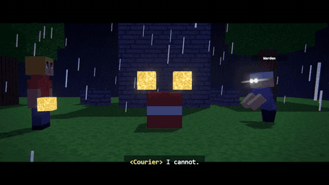

<p align="center"></p>

<p align="center">
  <a href="https://github.com/ViniciusNoetzold/mine-blockreel-skill-/actions/workflows/ci.yml"></a>
  <a href="LICENSE"></a>
  
  
  
</p>

<p align="center"><b>Descreva uma história. O Claude monta o briefing, pesquisa referências, escreve a lista de planos, constrói o mundo em blocos, anima, revisa os próprios quadros e renderiza um MP4.</b><br>
Sem modelo de vídeo: cada quadro é desenhado pelo Three.js num Chrome headless e codificado pelo ffmpeg. Suas skins, suas texturas, sua história.</p>

<p align="center"><a href="README.md">Read in English</a> · <a href="#-instalar">Instalar</a> · <a href="docs/PROMPTS.md">Prompts prontos</a> · <a href="docs/COVERAGE.md">O que ainda falta</a> · <a href="docs/STORYBOARD.md">Schema</a></p>

> Ferramenta de fã, não oficial. Sem relação com a Mojang ou a Microsoft. Não inclui nenhum asset do jogo ([docs/LEGAL.md](docs/LEGAL.md)).

---


### Novidades

- **Visual e som do jogo por padrão:** `python tools/vanilla.py fetch` (texturas originais) e `python tools/vanilla.py sounds` (efeitos sonoros originais)
  baixam das fontes da própria Mojang para um cache local (`work/vanilla/`, nunca vai para o git).
- **Gêneros** ([docs/GENRES.md](docs/GENRES.md)): curta cinematográfico, **opening de canal** (`python tools/opening.py "MEU CANAL" --out films/intro`) e episódio de série.
- **Produção sonora:** trilha original composta em código (`tools/score.py`), vozes offline com presets de personagem (`tools/voice.py`, vozes neurais Piper pt-BR
  ou as vozes do Windows) e mixagem com ducking.
- **Sua skin no vídeo:** se você mandar uma skin, ela é usada exatamente como veio (validada para funcionar no jogo também).
- **QA mais rígida:** checagem densa a cada 0,05 s pega personagem dentro de bloco, árvore ou parede.

## Veja funcionando

### Novo na v0.2: *Eu vs Herobrine* — um prompt, um plano, um filme

<p align="center"></p>

<p align="center"><a href="docs/media/herobrine.mp4"><b>▶ Assista ao filme de 40 s: <i>Eu vs Herobrine</i></b></a> (mp4, com os efeitos sonoros do jogo e trilha original)</p>

<table>
  <tr>
    <td></td>
    <td></td>
  </tr>
  <tr>
    <td></td>
    <td></td>
  </tr>
</table>

O filme inteiro é o plano de 30 linhas em [`examples/herobrine-duel/plan.json`](examples/herobrine-duel/plan.json), compilado pelo
`tools/compose.py` ([o diretor](docs/DIRECTOR-PLAN.md)): marcação, coreografia de luta, cobertura com a regra dos 180°, câmera lenta nos golpes
decisivos, passos, espadas, escudo e trovões com os sons do jogo, e uma trilha que vai de calma → tensão → batalha → silêncio → amanhecer.
O herói é uma **persona pintada a partir da descrição de uma foto** (`core/persona.py`); o Herobrine é um preset.

O que deixa com cara de jogo (v0.2):

- **O mundo é desenhado como o jogo desenha os chunks**: faces escondidas eliminadas (sem z-fighting, sem textura piscando, sem água
  mostrando o que tem embaixo), sombreamento por face do jogo, oclusão de ambiente (smooth lighting), **luz do céu e de tochas propagada bloco
  a bloco** (caverna é escura, tocha ilumina a noite com luz quente), mipmaps que impedem o "cintilar" de blocos distantes.
- **Escadas, lajes, cercas, muros, tochas, flores, grama alta, fogo**; terreno com biomas, arena, água, árvores (carvalho, bétula, pinheiro) e
  construções (casa, torre, ruínas, santuário) que **sempre ficam em chão limpo e nivelado** — nada de casa dentro de árvore.
- **Céu**: sol e lua quadrados, estrelas, a camada de nuvens do jogo, raios que iluminam a cena.
- **Espadas, ferramentas e arcos na mão**, extrudados dos sprites dos itens; golpes (corte, golpe por cima, estocada, guarda, esquiva, recuo
  com pulo, queda, levantar, conjurar, invocar, levitar); o flash vermelho de dano e a fumaça branca da morte.
- **A fonte do próprio jogo** em nametags, legendas no formato do chat (com acentos) e títulos.
- **Sua foto vira sua skin**: o Claude descreve a pessoa, o `core/persona.py` lê as cores exatas da foto e pinta uma skin 64x64 válida no jogo.


<p align="center"></p>

<p align="center"><a href="docs/media/the-last-torch.mp4"><b>▶ Assista ao filme completo de 34 s: <i>The Last Torch</i></b></a> (mp4, 5 MB)</p>

<table>
  <tr>
    <td></td>
    <td></td>
  </tr>
  <tr>
    <td></td>
    <td></td>
  </tr>
</table>

<sub><i>The Last Torch</i> ([`examples/last-torch`](examples/last-torch)) é um curta original de 34 s feito **com a própria skill**, seguindo o fluxo dela:
[briefing](examples/last-torch/brief.md) → [pesquisa na web com links](examples/last-torch/research.md) → [lista de planos](examples/last-torch/shotlist.md) → construção →
[registro de QA](examples/last-torch/qa.md) (três rodadas de revisão que acharam um farol escondido, um personagem flutuando sobre a cratera e pés cortados).
960x540, 30 fps, com pós-processamento, renderizado em 7,5 min com 4 workers. Nenhum asset do jogo.</sub>

---

## 🧰 As três skills

| Skill | O que faz | Prova |
|---|---|---|
| **`blockreel`** | Filmes. **Briefing → pesquisa na web (com links) → roteiro e lista de planos → construção → QA visual obrigatória → MP4.** | [`examples/last-torch`](examples/last-torch) |
| **`blockreel-skins`** | Skins de jogador. Pesquisa → plano de paleta (rampas de 4 tons) → pintura em camadas por código → validação → **turntable de 4 ângulos** que você itera. Classic e slim. | [`examples/skin-demo`](examples/skin-demo) |
| **`blockreel-textures`** | Conjuntos de texturas. Uma paleta para o conjunto todo → tiles que repetem → **verificador de emendas e paleta** → **prévia em cena** → `.zip` de resource pack com o pack format pesquisado e citado. | [`examples/texture-pack-demo`](examples/texture-pack-demo) |

## 🎬 O que o motor faz

Cada imagem é um render real do laboratório `examples/*-lab` correspondente (regenere com `python tools/make_media.py`).

**Atuação viva:** antecipação, overshoot, follow-through, mistura entre clipes, olhar que segue um alvo.


**Rostos:** olhos, boca e ferimentos mudam no tempo em qualquer skin; piscar automático; boca acompanha a legenda; olhos brilhantes.


<details open><summary><b>Câmera e transições</b>: handheld, Dutch, zoom, primeira pessoa, órbita, rack focus; flash, whip pan, fade; slow motion; letterbox 2.37:1</summary></details>
<details><summary><b>Partículas</b>: quebra, explosão, fumaça, fogo, faíscas, poeira, sangue, confete (determinísticas)</summary></details>
<details><summary><b>Ações de mundo</b>: rachaduras, colocar bloco, TNT com pavio, crateras, portas, baús, água e lava</summary></details>
<details><summary><b>Visual</b>: dia/noite, chuva, neve, bloom, profundidade de campo, grão, color grade</summary></details>
<details><summary><b>Mobs</b>: rigs de caixas (tipo creeper, porco, aranha) com a sua textura, e zumbis pelo rig do jogador</summary></details>

## 🧍 Skins e 🧱 texturas


A skin passa por 4 rodadas de revisão olhando o turntable; o pack passa por checagem de emendas (tiling 2x2 e 3x3), prévia em cena e build com número de formato **pesquisado** (46 = Java 1.21.4, tabela da [Minecraft Wiki](https://minecraft.wiki/w/Pack_format)).

---

## 🚀 Instalar

```bash
claude plugin marketplace add ViniciusNoetzold/mine-blockreel-skill-
claude plugin install blockreel@blockreel-market
```
ou clone e rode `claude` dentro da pasta:
```bash
git clone https://github.com/ViniciusNoetzold/mine-blockreel-skill- && cd mine-blockreel-skill-
npm install && pip install -r requirements.txt && python -m playwright install chromium
python -m pytest tests -q
```
Precisa de Node 20+, Python 3.11+, ffmpeg e Chrome/Chromium.

Depois peça, por exemplo: *"Faça uma animação de 30 s sobre um noob que acha um diamante."* Prompts completos (inclui uma **super produção de 30 s**): [docs/PROMPTS.md](docs/PROMPTS.md).

```bash
python tools/render.py examples/last-torch/story.json --preset preview --out preview.mp4   # prévia rápida
python tools/render.py examples/last-torch/story.json --workers 4 --out film.mp4           # 4 Chromes em paralelo
python tools/qa.py examples/last-torch/story.json --out out/qa                              # QA: quadros + checagens
```

## Limites honestos

- **Ainda não é completo.** O BlockReel não faz *qualquer* animação de Minecraft: faltam ferramentas/espadas na mão, blocos que não são cubo (escada, cerca, tocha), a maioria dos mobs, clipes de agachar/nadar/montar, armadura, sol/lua/estrelas, motion blur. Veja [docs/COVERAGE.md](docs/COVERAGE.md).
- **Velocidade:** render por software. O filme de 34 s levou 7,5 min com 4 workers. `--gpu` existe mas **não foi testado**.
- **Layouts de textura dos mobs não verificados** ([docs/MOBS.md](docs/MOBS.md)).
- **Nada foi testado dentro do jogo real.** Skins e packs foram validados e pré-visualizados no motor.
- Os manifestos do plugin batem com a documentação oficial até onde a leitura permitiu, mas `claude plugin validate` não pôde ser executado onde isto foi escrito.

## Licença

MIT para código e docs. Texturas, skins e exemplos incluídos: CC0.
