<h1 align="center">BlockReel</h1>

<p align="center"><b>Da sua ideia a um filme animado no estilo Minecraft.</b></p>

<p align="center">Dirija personagens, cenários e câmeras com um roteiro editável. O BlockReel desenha cada quadro em Three.js, gera a trilha e exporta o filme em MP4.</p>

<p align="center">
  <a href="https://github.com/ViniciusNoetzold/mine-blockreel-skill/actions/workflows/ci.yml"></a>
  <a href="LICENSE"></a>
  <a href="plugin/skills/blockreel/SKILL.md"></a>
  <a href="https://github.com/ViniciusNoetzold/mine-blockreel-skill/stargazers"></a>
</p>

<p align="center">
  <a href="README.md">English</a> · <a href="#começo-rápido">Começo rápido</a> · <a href="#timelapses-de-construção">Timelapses</a> · <a href="#fluxo-cinematográfico">Fluxo cinematográfico</a> · <a href="#galeria-de-filmes">Filmes</a> · <a href="#contribua">Contribua</a>
</p>

<p align="center">
  <a href="https://viniciusnoetzold.github.io/mine-blockreel-skill/#blockreel-promo">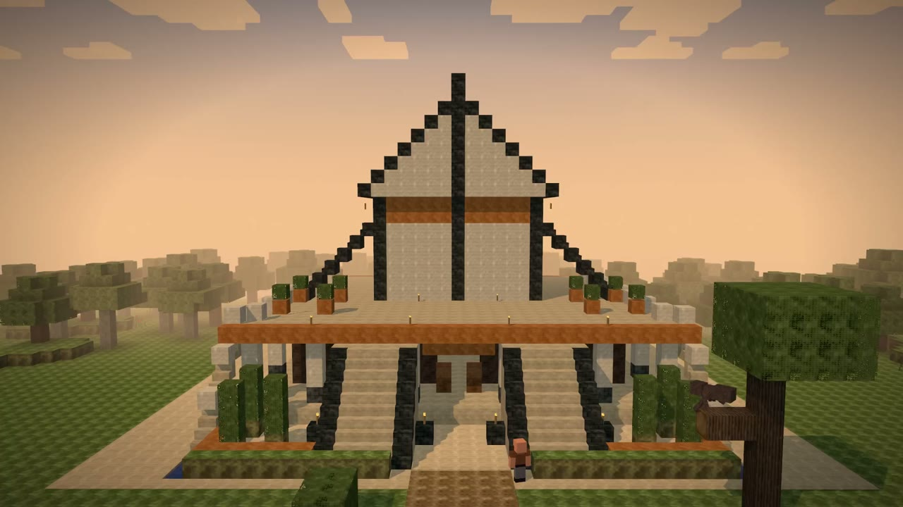</a>
</p>

<p align="center">
  <a href="https://viniciusnoetzold.github.io/mine-blockreel-skill/#blockreel-promo"><b>▶ Assista ao trailer cinematográfico do BlockReel com som (1 min 51 s)</b></a><br>
  Veja a cabana e o templo ganharem forma, com a construção completa da <i>Praça do Horizonte</i> e o curta <i>Primeira Noite</i> na íntegra.<br>
  <a href="examples/blockreel-promo/">Arquivos de produção</a> · <a href="#começo-rápido">Experimente as skills</a>
</p>

## Começo rápido

### Use o BlockReel no Codex

Clone o repositório e abra a pasta clonada como projeto no Codex. Comece o pedido do filme pedindo ao Codex que leia `plugin/skills/blockreel/SKILL.md` nessa pasta. Os comandos de marketplace abaixo instalam o plugin do Claude Code.

### Use o plugin no Claude Code

```bash
claude plugin marketplace add ViniciusNoetzold/mine-blockreel-skill
claude plugin install blockreel@blockreel-market
```

Abra uma sessão no Claude Code e chame `/blockreel:blockreel`. Siga as instruções da skill para preparar o repositório do renderizador.

<details>
<summary><b>Atualize uma instalação existente</b></summary>

```bash
claude plugin marketplace update blockreel-market
claude plugin update blockreel@blockreel-market
```

Abra uma nova sessão para carregar a atualização. [Atualizações de plugins no Claude Code](https://code.claude.com/docs/en/discover-plugins#keep-plugins-updated)

</details>

### Timelapses de construção

Anexe uma imagem de referência e peça ao BlockReel para recriar a construção e mostrar a montagem bloco a bloco. No Claude Code, use `/blockreel:blockreel-builds`. No Codex, peça a leitura da [skill de construção](plugin/skills/blockreel-builds/SKILL.md) no repositório. O fluxo confere a fachada visível com a referência e registra as decisões sobre laterais ocultas, profundidade e interior. Envie outros ângulos ou medidas quando esses detalhes forem importantes.

[Planta da casa](examples/house-timelapse/) · [Mapa da cidade e bairros](examples/city-timelapse/) · [Guia de timelapses](docs/BUILD-TIMELAPSE.md)

### Experimente um prompt cinematográfico

> Faça um curta de 30 segundos sobre um mensageiro que precisa atravessar uma ponte congelada prestes a desabar. Siga o fluxo de produção cinematográfica. Dê a cada cena um acontecimento visual claro e sincronize a trilha e os efeitos originais com a ação. Revise a prévia em movimento e com som, corrija os problemas e entregue o MP4 final, o storyboard editável e o registro de revisão.

Encontre mais gêneros e exemplos nos [prompts prontos](docs/PROMPTS.md).

### Rode as ferramentas diretamente

Instale **Node.js 20+**, **Python 3.11+** e **FFmpeg**. Confira se `ffmpeg` e `ffprobe` estão no `PATH`. O renderizador usa Chromium e funciona com renderização por software.

```bash
git clone https://github.com/ViniciusNoetzold/mine-blockreel-skill
cd mine-blockreel-skill
npm ci
python -m pip install -r requirements.txt
python -m playwright install chromium
python tools/render.py examples/hello-world/story.json --preset preview --out films/hello/preview.mp4
```

Abra `films/hello/preview.mp4` para conferir a instalação. O preset `preview` reduz a largura e a altura pela metade e renderiza a 12 fps para testar ajustes. Se precisar apontar para um Chrome ou Chromium já instalado, use `CHROME_PATH`.

Para comparar seu render com o filme publicado, use o mesmo storyboard e áudio original. [Teste os dois segundos da cena da tocha](examples/first-night/README.md#teste-rápido-com-a-cena-da-tocha)

### Renderize Aurora Express

Rode a partir da raiz do repositório depois da instalação. O exemplo usa arte original, trilha gerada em código e efeitos sincronizados com os passos, os trilhos, os impactos e o sinal.

```bash
python examples/aurora-express/make_audio.py
python tools/qa.py examples/aurora-express/story.json --out films/aurora-express/qa --no-md
python tools/render.py examples/aurora-express/story.json --preset preview --out films/aurora-express/preview.mp4
```

Revise `films/aurora-express/qa/contact-sheet.png` e assista à prévia com som. Depois, renderize o filme completo em 1280 × 720, a 24 fps.

```bash
python tools/render.py examples/aurora-express/story.json --workers 2 --crf 20 --out films/aurora-express/film.mp4
python tools/check_media.py films/aurora-express/film.mp4 --duration 30 --size 1280x720 --fps 24 --require-audio
```

## Fluxo cinematográfico

1. **Briefing e decupagem.** Defina a duração, os momentos da história, a linguagem visual e o que cada plano comunica. Valide os planos mais caros com quadros de teste.
2. **Construa a sequência.** Compile o `plan.json` com `tools/compose.py` para gerar marcações de cena, cobertura de câmera, coreografia e entradas de som. Edite o `story.json` diretamente quando a cena exigir cenários, atuação e câmeras próprios.
3. **Revise imagem e som.** Rode `tools/qa.py`, examine a folha de contato para verificar enquadramento e continuidade e assista à prévia com a mixagem. Corrija no projeto e refaça as checagens afetadas.
4. **Finalize e exporte.** Renderize o storyboard aprovado em MP4 e exporte a miniatura, o GIF, as legendas ou a versão vertical conforme a entrega.

Veja como planejar os planos, estimar o render, montar o som e fazer a conferência final no [guia de produção cinematográfica](docs/CINEMATIC-WORKFLOW.md).

<details>
<summary><b>Compile um filme a partir de uma sequência de ações</b></summary>

Edite o [plano de A Casa Nova](examples/creeper-surprise/plan.json) e compile para gerar o storyboard completo.

```bash
python tools/compose.py examples/creeper-surprise/plan.json --out films/casa
python tools/qa.py films/casa/story.json --out films/casa/qa
python tools/render.py films/casa/story.json --preset preview --out films/casa/preview.mp4
```

</details>

## Galeria de filmes

[Assista aos filmes do BlockReel no navegador](https://viniciusnoetzold.github.io/mine-blockreel-skill/). Os players têm controles nativos.

[Primeira Noite (60 s)](https://viniciusnoetzold.github.io/mine-blockreel-skill/#first-night) · [Reel em 9:16](https://viniciusnoetzold.github.io/mine-blockreel-skill/#first-night-reel) · [Aurora Express (30 s)](https://viniciusnoetzold.github.io/mine-blockreel-skill/#aurora-express)

[Assista ao timelapse da casa](https://viniciusnoetzold.github.io/mine-blockreel-skill/#house-timelapse) para ver a construção da fundação ao exterior pronto. [Exemplo editável](examples/house-timelapse/)

[Assista à construção da Praça do Horizonte](https://viniciusnoetzold.github.io/mine-blockreel-skill/#city-timelapse), das avenidas à feira, ao jardim, às casas e à torre do relógio. [Mapa editável](examples/city-timelapse/)

### Demos anteriores

<table>
  <tr>
    <td width="50%" valign="top">
      <a href="https://viniciusnoetzold.github.io/mine-blockreel-skill/#vila-viva">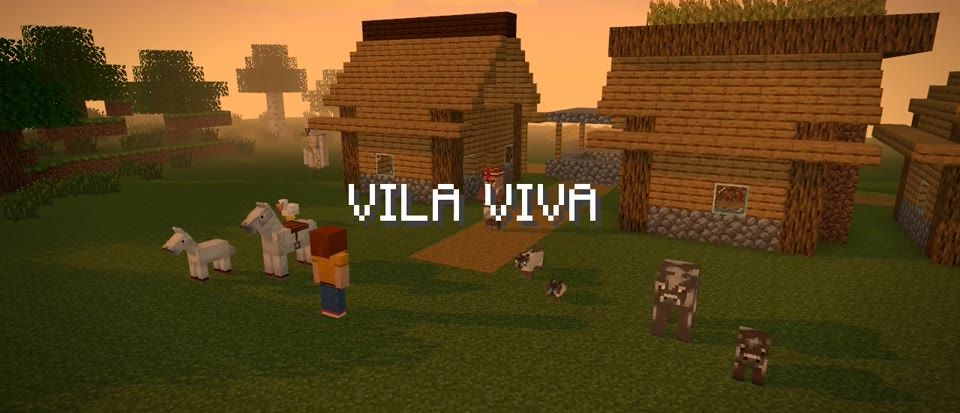</a><br>
      <b><a href="https://viniciusnoetzold.github.io/mine-blockreel-skill/#vila-viva">▶ Vila Viva</a></b> · 28 s<br>
      Uma vila ao entardecer, filhotes de mobs, um passeio a cavalo e fogos. <a href="examples/village-life/plan.json">Plano</a>
    </td>
    <td width="50%" valign="top">
      <a href="https://viniciusnoetzold.github.io/mine-blockreel-skill/#herobrine">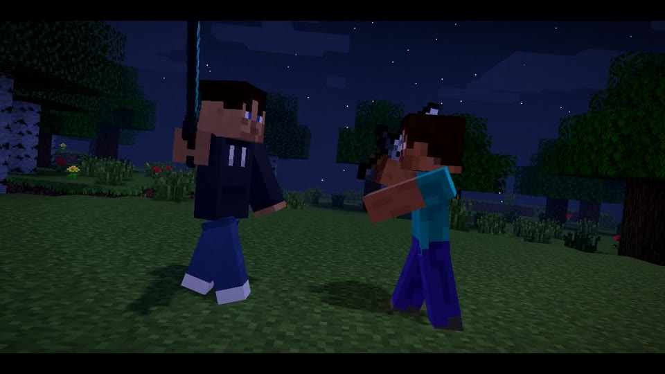</a><br>
      <b><a href="https://viniciusnoetzold.github.io/mine-blockreel-skill/#herobrine">▶ Eu vs Herobrine</a></b> · 40 s<br>
      Uma persona personalizada enfrenta Herobrine em um duelo de espadas. <a href="examples/herobrine-duel/plan.json">Plano</a>
    </td>
  </tr>
  <tr>
    <td width="50%" valign="top">
      <a href="https://viniciusnoetzold.github.io/mine-blockreel-skill/#creeper-surprise">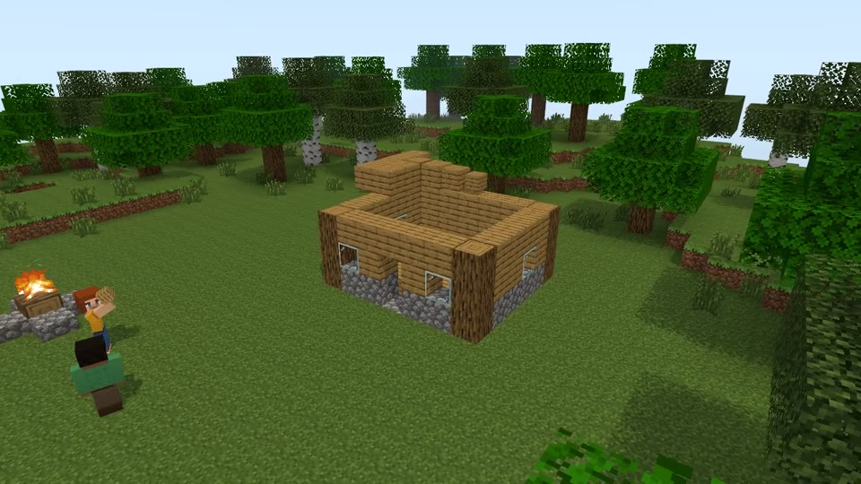</a><br>
      <b><a href="https://viniciusnoetzold.github.io/mine-blockreel-skill/#creeper-surprise">▶ A Casa Nova</a></b> · 39 s<br>
      Dois amigos constroem uma casa. Um creeper tem outros planos. <a href="examples/creeper-surprise/plan.json">Plano</a>
    </td>
    <td width="50%" valign="top">
      <a href="https://viniciusnoetzold.github.io/mine-blockreel-skill/#zombie-night">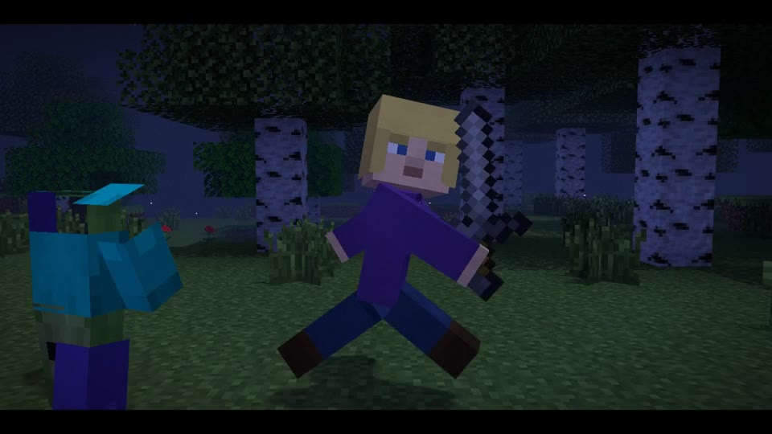</a><br>
      <b><a href="https://viniciusnoetzold.github.io/mine-blockreel-skill/#zombie-night">▶ Primeira Noite (demo anterior)</a></b> · 31 s<br>
      Uma perseguição na floresta termina em um combate com espada de pedra. <a href="examples/zombie-night/plan.json">Plano</a>
    </td>
  </tr>
  <tr>
    <td width="50%" valign="top">
      <a href="https://viniciusnoetzold.github.io/mine-blockreel-skill/#farol-negro">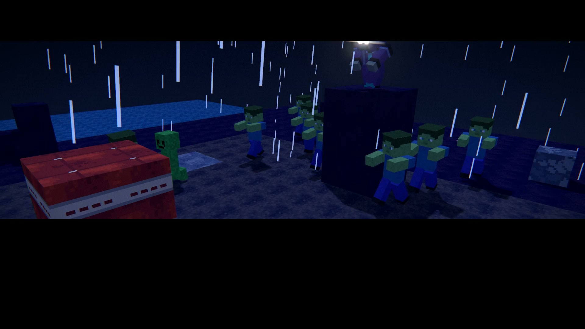</a><br>
      <b><a href="https://viniciusnoetzold.github.io/mine-blockreel-skill/#farol-negro">▶ Farol Negro</a></b> · 22 s<br>
      Uma guerreira solitária defende um farol contra uma horda.
    </td>
    <td width="50%" valign="top">
      <a href="https://viniciusnoetzold.github.io/mine-blockreel-skill/#the-last-torch">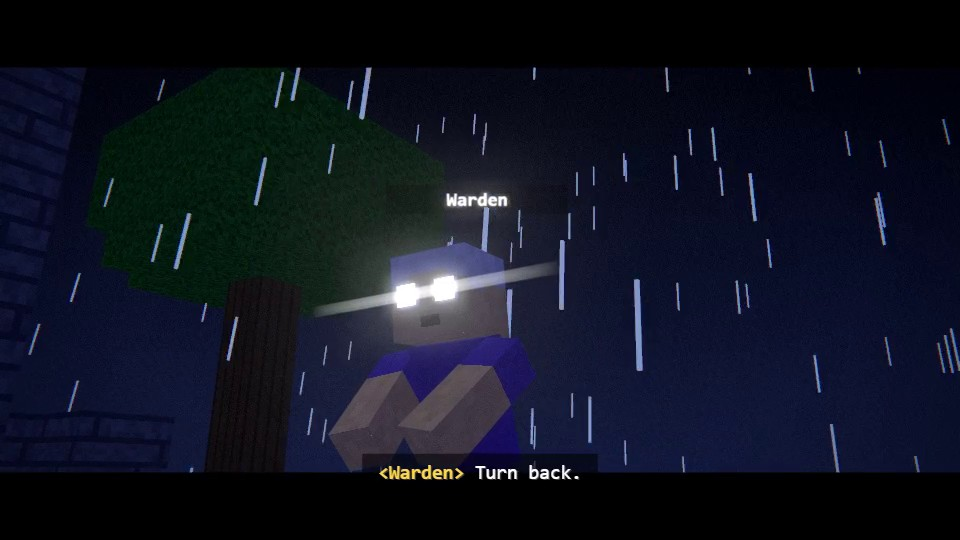</a><br>
      <b><a href="https://viniciusnoetzold.github.io/mine-blockreel-skill/#the-last-torch">▶ The Last Torch</a></b> · 34 s (sem áudio)<br>
      Um curta cinematográfico com briefing, decupagem e relatório de QA. <a href="examples/last-torch">Arquivos de produção</a>
    </td>
  </tr>
</table>

Também dá para fazer aberturas de canal, histórias de cotidiano e episódios com diálogo. [Guia de gêneros](docs/GENRES.md)

### Vídeos de marketing e divulgação

O mesmo renderizador serve para apresentar produtos em blocos, anunciar eventos e fazer vinhetas de marca. Monte o produto ou logotipo na cena, use títulos e uma chamada para ação, sincronize trilha e efeitos e exporte em MP4 horizontal ou Reel 9:16. O fluxo produz animações. Campanhas montadas a partir de gravações reais usam uma etapa de edição separada. [Guia de gêneros](docs/GENRES.md) · [Guia de Reels](docs/REELS.md)

## O que dá para dirigir

| Área | Recursos |
| --- | --- |
| Mundos | Biomas, cavernas, vilas geradas, objetos de cena, mudanças animadas, clima e iluminação por bloco |
| Personagens | Skins classic e slim, altura personalizável, lobo sem cache, atuação facial e emotes com transições suaves. [Guia de mobs](docs/MOBS.md) |
| Equipamento | Capas animadas com troca em cena, escudos e sprites de mods para itens na mão. [Guia de equipamentos](docs/EQUIPMENT.md) |
| HUD opcional | Chat de eventos, barra rápida, inventário e receitas encenadas. [Guia de HUD](docs/HUD.md) |
| Câmera e efeitos | Órbita, câmera na mão, primeira pessoa, mudança de foco, rampas de velocidade, partículas e tratamento de cor |
| Som | Trilha original, efeitos sincronizados, vozes offline opcionais e redução da música durante as falas |
| Entrega | MP4, GIF, [Reels em 9:16](docs/REELS.md), legendas SRT e miniatura |

<details>
<summary><b>Veja quadros renderizados no motor</b></summary>

<p>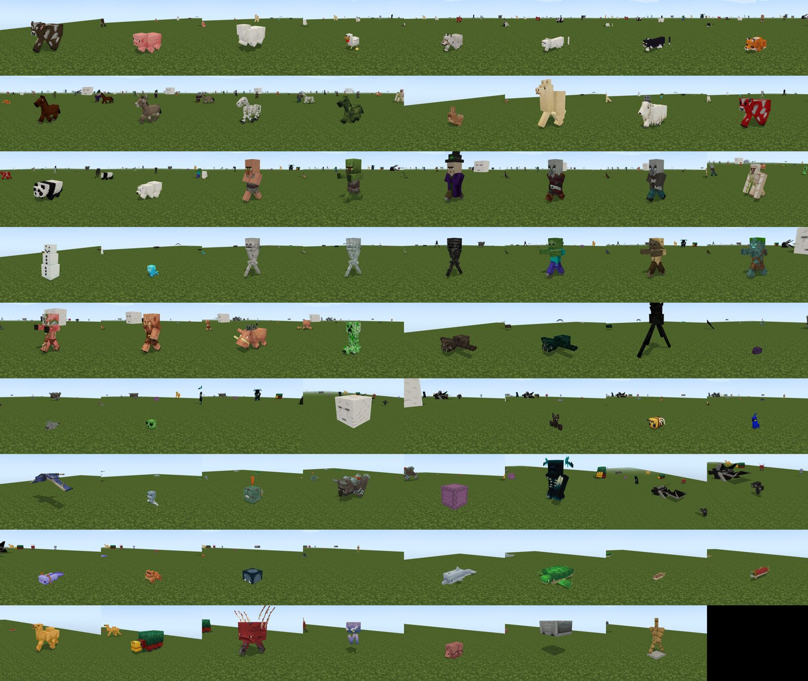<br><sub>Mobs com o cache opcional de arquivos do jogo.</sub></p>
<p>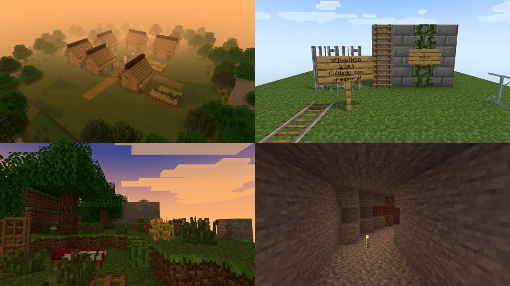<br><sub>Vilas geradas, objetos de cena e cavernas.</sub></p>
<p>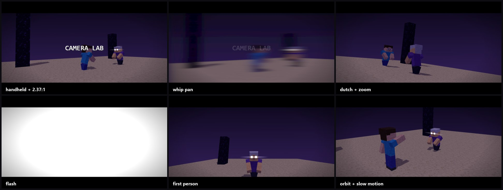<br><sub>Testes de câmera e transições.</sub></p>
<p>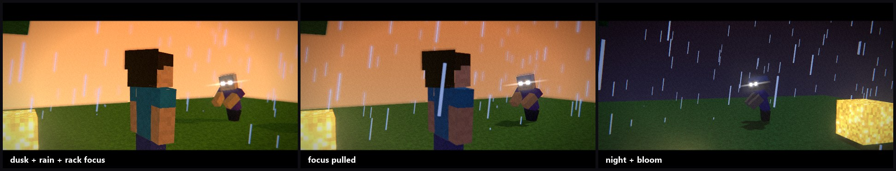<br><sub>Testes de iluminação e pós-processamento.</sub></p>

</details>

O motor ainda tem lacunas em redstone, barcos e grandes multidões. O tempo de render varia com a complexidade da cena, a resolução e o hardware. Use o preset de prévia ou renderize um quadro com `--frame` para ajustar um plano. [Cobertura do motor](docs/COVERAGE.md)

### Quatro skills em um plugin

| Skill | Use para |
| --- | --- |
| [`blockreel`](plugin/skills/blockreel/SKILL.md) | Dirigir um filme animado a partir de um prompt ou referência, até a mixagem e a revisão visual |
| [`blockreel-builds`](plugin/skills/blockreel-builds/SKILL.md) | Converter referências de construções e mapas de bairros em plantas editáveis e timelapses por etapas. [Casa](examples/house-timelapse/) · [Cidade](examples/city-timelapse/) |
| [`blockreel-skins`](plugin/skills/blockreel-skins/SKILL.md) | Pintar e validar skins de jogadores com uma prévia em quatro ângulos. [Exemplo de skin](examples/skin-demo) |
| [`blockreel-textures`](plugin/skills/blockreel-textures/SKILL.md) | Criar texturas de blocos e itens que se repetem sem emendas, conferir em cena e gerar um resource pack ZIP. [Exemplo de texturas](examples/texture-pack-demo) |

## Referências do projeto

| Onde começar | O que cobre |
| --- | --- |
| [Planos de direção](docs/DIRECTOR-PLAN.md) · [Esquema do storyboard](docs/STORYBOARD.md) | Ações para o compilador e campos para cenas com direção manual |
| [Direção](DIRECTOR.md) · [QA](docs/QA.md) · [Motor](TECHNIQUE.md) | Encenação, desempenho, trabalho de câmera e verificação |
| [Mobs](docs/MOBS.md) · [Skins](docs/SKINS.md) · [Resource packs](docs/RESOURCE-PACKS.md) | Modelos, arte de personagens e texturas de blocos |
| [Política de arquivos](docs/LEGAL.md) | Arte incluída, cache local do jogo e arquivos de terceiros |

O BlockReel é um projeto independente de fãs. O repositório inclui texturas e skins originais em CC0, além dos arquivos de projeto e geradores de áudio dos curtas publicados. *Primeira Noite* usa a arte incluída, sprites próprios de carvão, a fonte CSS do renderizador e uma trilha com efeitos gerados a partir das marcações de áudio do projeto. Ele roda sem Minecraft ou o cache do jogo. [Arquivos de *Primeira Noite*](examples/first-night/)

O cache opcional em `work/vanilla/` pode mudar o visual e o som. `python tools/vanilla.py all` baixa texturas, efeitos sonoros, a fonte do jogo, modelos de mobs e texturas de equipamentos. Os efeitos automáticos de jogo do compilador de ações dependem do cache de sons. Para reproduzir um render, registre quais arquivos o projeto usa e mantenha os arquivos do jogo fora do repositório. [Política de arquivos](docs/LEGAL.md)

## Contribua

Compartilhe um filme feito com o BlockReel, relate um problema de render com o menor storyboard que o reproduz ou contribua com uma ação, animação, estilo ou correção na documentação. [Abra uma issue](https://github.com/ViniciusNoetzold/mine-blockreel-skill/issues/new) · [Cobertura do motor](docs/COVERAGE.md)

Para mudanças no código, rode a suíte Python e as checagens do motor.

```bash
python -m pip install pytest
python -m pytest tests -q
node tests/anim_check.mjs
node tests/world_check.mjs
node tests/geo_check.mjs
```

Se você criar algo com o BlockReel, deixe uma estrela para ajudar outros criadores a encontrar o projeto. [BlockReel no GitHub](https://github.com/ViniciusNoetzold/mine-blockreel-skill)

## Licença

Código e documentação sob [MIT](LICENSE). As texturas e skins originais incluídas são CC0. Minecraft é uma marca registrada da Mojang Synergies AB. [Política de arquivos](docs/LEGAL.md)
