<p align="center">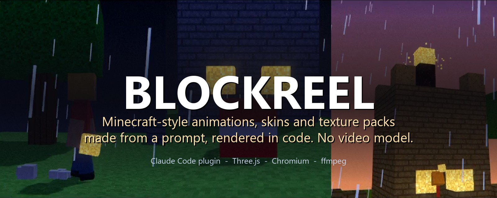</p>

<h1 align="center">BlockReel</h1>

<p align="center"><b>Escreva uma história. Receba um filme de Minecraft.</b><br>
Um plugin do Claude Code que transforma um prompt (e, se quiser, a sua skin, a sua foto ou as suas texturas) num vídeo animado pronto:
roteiro, decupagem, um mundo de blocos, atuação, câmera, efeitos sonoros, trilha original, revisão de qualidade, MP4. Sem modelo de vídeo: cada quadro é desenhado por código.</p>

<p align="center">
  <a href="https://github.com/ViniciusNoetzold/mine-blockreel-skill-/actions/workflows/ci.yml"></a>
  <a href="LICENSE"></a>
  
  
  
  
</p>

<p align="center">
  <a href="README.md">🇺🇸 Read in English</a> ·
  <a href="#-filmes-feitos-com-o-blockreel">Filmes</a> ·
  <a href="#-do-prompt-ao-filme">Como funciona</a> ·
  <a href="#-recursos">Recursos</a> ·
  <a href="#-instalação">Instalação</a> ·
  <a href="#-começo-rápido">Começo rápido</a> ·
  <a href="docs/COVERAGE.md">O que falta</a>
</p>

<p align="center"><a href="docs/media/vila-viva.mp4">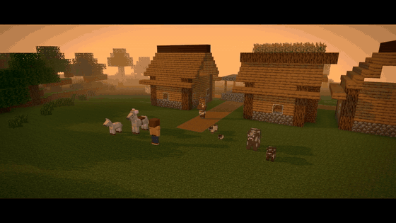</a></p>
<p align="center"><a href="docs/media/vila-viva.mp4"><b>▶ Assista <i>Vila Viva</i> (28 s, com som)</b></a> — um plano de 40 linhas, compilado e renderizado pelo BlockReel. Todos os mobs se movem com as animações do próprio jogo.</p>

> **Ferramenta de fã, não oficial.** Sem vínculo com a Mojang ou a Microsoft. O repositório **não traz nenhum arquivo do jogo**: `tools/vanilla.py`
> baixa as texturas, modelos, animações e sons originais das fontes públicas da própria Mojang para um cache local (ignorado pelo git) na *sua*
> máquina ([docs/LEGAL.md](docs/LEGAL.md)). Sem o cache, o BlockReel usa as próprias texturas CC0.

---

## 🎬 Filmes feitos com o BlockReel

Todos os filmes abaixo foram produzidos pela skill a partir de um plano curto. Clique numa imagem para assistir o MP4 (o GitHub toca no navegador).

<table>
  <tr>
    <td width="50%" valign="top">
      <a href="docs/media/vila-viva.mp4"></a><br>
      <b><a href="docs/media/vila-viva.mp4">▶ Vila Viva</a></b> · cotidiano · 28 s<br>
      <sub>Uma vila gerada, um bibliotecário e um fazendeiro, uma criança correndo, uma vaca com o bezerro, gata siamesa e filhote, um passeio
      num cavalo branco com o potro atrás, fogos ao anoitecer. Mostra: vilas, filhotes, variantes, montaria, as animações dos mobs do jogo.
      <a href="examples/village-life/plan.json">plano</a></sub>
    </td>
    <td width="50%" valign="top">
      <a href="docs/media/herobrine.mp4">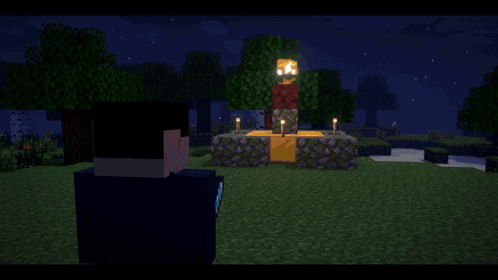</a><br>
      <b><a href="docs/media/herobrine.mp4">▶ Eu vs Herobrine</a></b> · ação · 40 s<br>
      <sub>O herói é uma persona pintada a partir da descrição de uma foto. Revelação no raio, diálogo, duelo de espadas com a regra dos 180°,
      teleporte, poder do raio, golpe final em câmera lenta. <a href="examples/herobrine-duel/plan.json">plano</a></sub>
    </td>
  </tr>
  <tr>
    <td width="50%" valign="top">
      <a href="docs/media/creeper-surprise.mp4">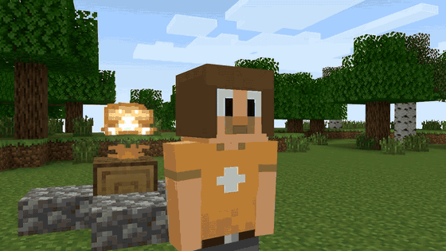</a><br>
      <b><a href="docs/media/creeper-surprise.mp4">▶ A Casa Nova</a></b> · comédia · 39 s<br>
      <sub>Dois amigos constroem uma casa em timelapse; um creeper chega de fininho; metade da casa some; "...de novo não."
      <a href="examples/creeper-surprise/plan.json">plano</a></sub>
    </td>
    <td width="50%" valign="top">
      <a href="docs/media/zombie-night.mp4"></a><br>
      <b><a href="docs/media/zombie-night.mp4">▶ Primeira Noite</a></b> · sobrevivência · 31 s<br>
      <sub>A primeira noite: um zumbi aparece, perseguição pela floresta, luta com espada de pedra, vitória sob as estrelas.
      <a href="examples/zombie-night/plan.json">plano</a></sub>
    </td>
  </tr>
  <tr>
    <td width="50%" valign="top">
      <a href="docs/media/farol-negro.mp4">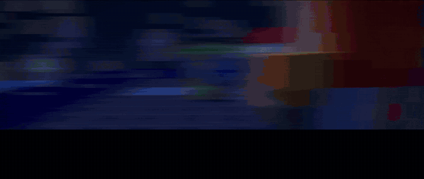</a><br>
      <b><a href="docs/media/farol-negro.mp4">▶ Farol Negro</a></b> · cinematográfico · 22 s · 2.37:1<br>
      <sub>Uma guerreira defende o último farol contra uma horda. 18 planos, skins e blocos originais, três atos de luz, vozes, 3 rodadas de revisão.</sub>
    </td>
    <td width="50%" valign="top">
      <a href="docs/media/the-last-torch.mp4"></a><br>
      <b><a href="docs/media/the-last-torch.mp4">▶ The Last Torch</a></b> · cinematográfico · 34 s<br>
      <sub>A primeira demo, feita com o fluxo completo: <a href="examples/last-torch/brief.md">briefing</a> →
      <a href="examples/last-torch/research.md">pesquisa</a> → <a href="examples/last-torch/shotlist.md">decupagem</a> → <a href="examples/last-torch/qa.md">revisão</a>.</sub>
    </td>
  </tr>
</table>

Não é só luta: comédia, sobrevivência, cotidiano, timelapse de construção, mineração, episódios com diálogo, aberturas de canal. Veja [docs/GENRES.md](docs/GENRES.md).

---

## 🧭 Do prompt ao filme

```text
Você:  "Faz um vídeo de Minecraft meu contra o Herobrine. Usa essa foto minha."
```

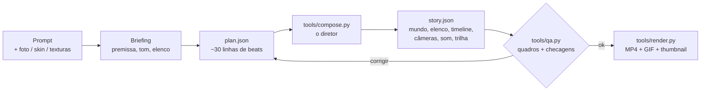

1. **Briefing.** O Claude define premissa, tom, duração e elenco (a sua skin, uma persona pintada a partir da sua foto, ou presets como o Herobrine).
2. **Plano.** Escreve uma lista curta de *beats*: `establish`, `walk`, `line`, `duel`, `build`, `ride`, `creeper`, `chase`, `ending`... ([docs/DIRECTOR-PLAN.md](docs/DIRECTOR-PLAN.md)).
3. **Direção.** `tools/compose.py` faz a matemática do cinema: marcação, coreografia de luta, cobertura com a regra dos 180°, diálogo por cima do ombro,
   corte na ação, câmera lenta nos golpes decisivos, passos e golpes com os sons do jogo, e uma trilha original que segue os beats.
4. **Revisão.** `tools/qa.py` gera uma folha de contato e checa a cada 0,05 s: personagem dentro da parede, câmera dentro de árvore, rosto de costas,
   enquadramento cortado, legenda cortada, plano longo demais. O Claude **olha** os quadros e corrige o plano.
5. **Render.** O Chrome headless desenha cada quadro (`renderAt(t)` é função pura do tempo), o ffmpeg codifica, o áudio é mixado com ducking.
   Exporta: MP4, GIF, versão vertical 9:16 re-renderizada, legendas SRT, thumbnail com título.

<details>
<summary><b>Como é um plano</b> (<i>A Casa Nova</i> inteiro)</summary>

```json
{
 "title": "A Casa Nova", "size": [1280, 720], "style": "classic-2012",
 "world": {"biome": "plains", "arena": {"center": [0, 0], "radius": 13}, "structures": [{"structure": "campfire", "pos": [-6, null, 6]}]},
 "cast": {
  "lia":  {"persona": {"model": "slim", "hair": {"color": "#7a3a1a", "style": "ponytail"}, "top": {"type": "tshirt", "color": "#e0a030"}}},
  "beto": {"persona": {"hair": {"style": "curly"}, "glasses": {"style": "square"}, "top": {"type": "shirt", "pattern": "plaid"}}},
  "creeper": {"mob": "creeper", "hidden": true}
 },
 "beats": [
  {"beat": "establish", "dur": 3.5, "text": "A CASA NOVA"},
  {"beat": "line", "who": "lia", "to": "beto", "text": "Bora construir nossa casa aqui!", "emotion": "smile"},
  {"beat": "build", "who": "lia", "structure": "house", "at": [3, -4], "dur": 9},
  {"beat": "look", "who": "lia", "at": "creeper", "emotion": "scared"},
  {"beat": "creeper", "who": "creeper", "target": "beto", "radius": 3.5},
  {"beat": "line", "who": "beto", "to": "lia", "text": "...de novo não.", "emotion": "sad"},
  {"beat": "ending", "dur": 4.5, "text": "Fim?"}
 ]
}
```
`python tools/compose.py plan.json --out films/casa` → `story.json`, `music.wav`, `skins/`, `shotlist.md`. Resumido de
[examples/creeper-surprise/plan.json](examples/creeper-surprise/plan.json).
</details>

---

## ✨ Recursos

<table>
<tr><td width="50%" valign="top">

**🌍 Um mundo desenhado como o jogo desenha**
- mesher por chunks com remoção de faces ocultas: sem z-fighting, sem piscar, sem água transparente errada
- o sombreamento por face do jogo, oclusão de ambiente (smooth lighting), **luz do céu e de tochas propagada bloco a bloco**
- escadas, lajes, cercas, muros, portas, alçapões, escadas de mão, vinhas, trilhos, vidraças, camas, plantações, placas com texto, tochas, fogo, água e lava correndo
- terreno com biomas, cavernas e minérios, túneis, **vilas** em terreno nivelado (caminhos, casas viradas para os caminhos, fazendas, poço, postes)
- construções nunca ficam dentro de árvores; câmeras nunca ficam presas nas copas
- céu, sol e lua quadrados, estrelas, as nuvens do jogo, raios, chuva e neve
- **milhões de blocos**: 1,7 M blocos montados em 5 s, 0,7 s por quadro em 720p sem GPU

</td><td width="50%" valign="top">

**🐄 Todos os mobs, se mexendo como no jogo**
- ~70 mobs com a geometria e as texturas do próprio jogo (`tools/vanilla.py mobs`)
- **as animações do próprio jogo**: um interpretador de Molang executa os scripts de animação de cada mob: o trote do cavalo, as asas da abelha, as varas do blaze, o slime de magma, os braços do aldeão...
- **filhotes** com os modelos de filhote do jogo (bezerro, pintinho, filhote de lobo, gatinho, potro, aldeão criança...)
- **variantes**: vacas, porcos e galinhas do frio e do calor, raças de gato, pelagens de lobo, cores de cavalo e lhama, biomas e profissões de aldeão
- mobs que brilham no escuro (blaze, cubo de magma, lula brilhante)
- montaria (cavalo, camelo, porco, carrinho...), creepers que incham e explodem construções

</td></tr>
<tr><td valign="top">

**🧍 Personagens e atuação**
- a sua skin (classic/slim, legado 64x32, as duas camadas) ou uma **persona pintada a partir da sua foto**
- rostos que piscam, falam (lip-sync pelo texto ou pelo áudio), mostram emoção e ferimentos, olhos brilhando
- 50+ animações com antecipação e follow-through: lutas (corte, golpe por cima, estocada, defesa, esquiva, empurrão), nadar, rastejar, escalar, montar, comer, dormir, planar, construir, minerar...
- armaduras (8 materiais, couro tingido), escudo, capa, élitro, espadas, ferramentas e arcos na mão a partir dos sprites dos itens

</td><td valign="top">

**🎥 Direção, câmera, som**
- um compilador de direção: beats → marcação, coreografia, cobertura, cortes, som e trilha
- câmera na mão, holandesa, órbita, grua, primeira pessoa, troca de foco, whip pan, flashes, rampas de velocidade, letterbox
- bloom, profundidade de campo, grão, color grade, motion blur
- os efeitos sonoros do jogo; uma **trilha original** composta em código; vozes offline; mixagem com ducking
- revisão que pega os erros que o público veria
- exporta MP4, GIF, vertical 9:16, SRT, thumbnails

</td></tr>
</table>

### Galeria

Cada imagem é um render de verdade. Abra uma seção:

<details open>
<summary><b>Mobs</b>: cerca de 70 mobs com a geometria, a textura e as animações do próprio jogo</summary>

</details>

<details open>
<summary><b>Filhotes e variantes</b>: os modelos de filhote do jogo; pelagens, raças, biomas e profissões (<code>"baby": true</code>, <code>"variant": "siamese"</code>)</summary>
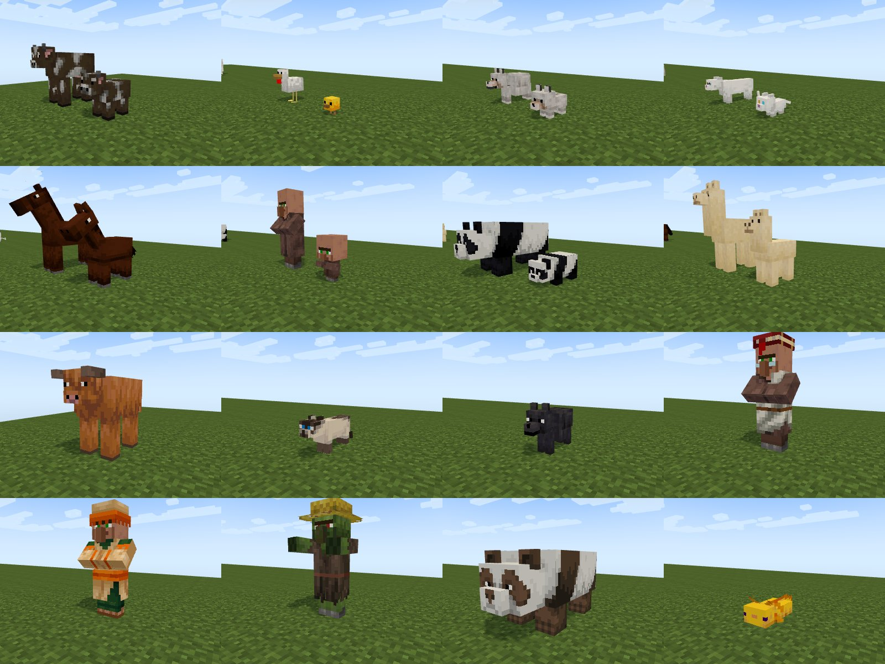
</details>

<details>
<summary><b>Vilas, cavernas e blocos</b>: vilas em terreno nivelado, cavernas com minérios, túneis iluminados, portas, camas, placas com texto, escadas, vinhas, trilhos, plantações</summary>

</details>

<details>
<summary><b>Mundos enormes</b>: milhões de blocos; chunks além da névoa não são desenhados</summary>
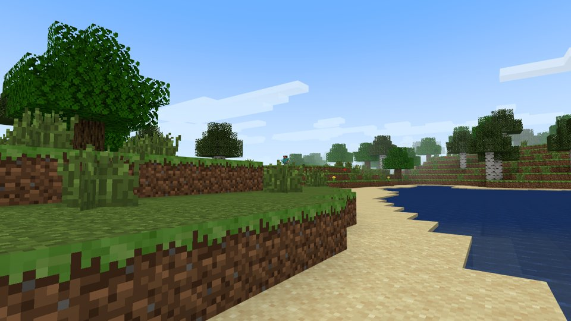
</details>

<details>
<summary><b>Equipamento e movimento</b>: armadura, escudo, capa, élitro; montar, nadar, rastejar, escalar, comer, beber, dormir, planar</summary>
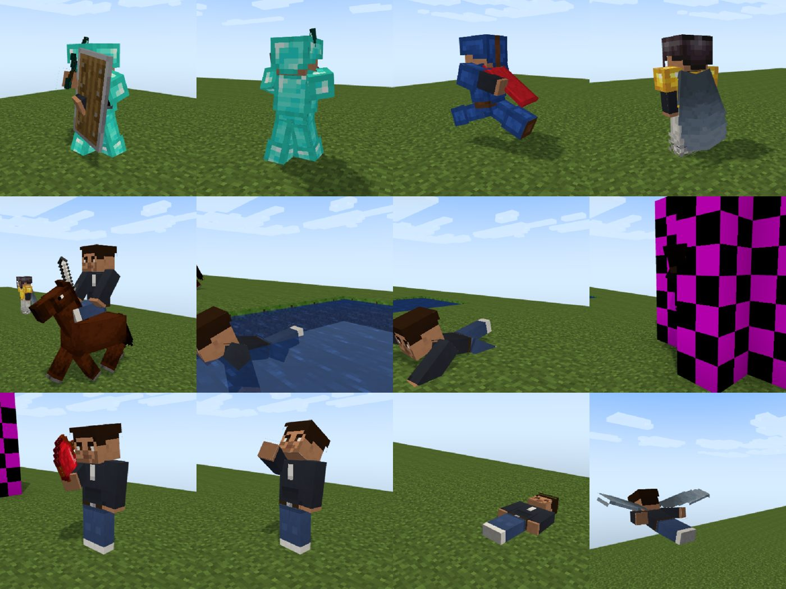
</details>

<details>
<summary><b>Atuação</b>: antecipação, overshoot e follow-through; transições entre animações; cabeça que acompanha um alvo</summary>
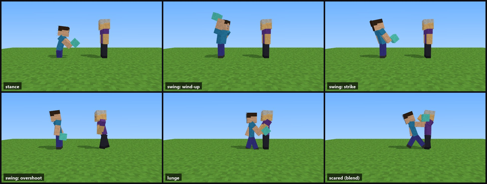
</details>

<details>
<summary><b>Rostos</b>: olhos, boca e ferimentos ao longo do tempo em qualquer skin; piscar; lip-sync; olhos brilhando</summary>
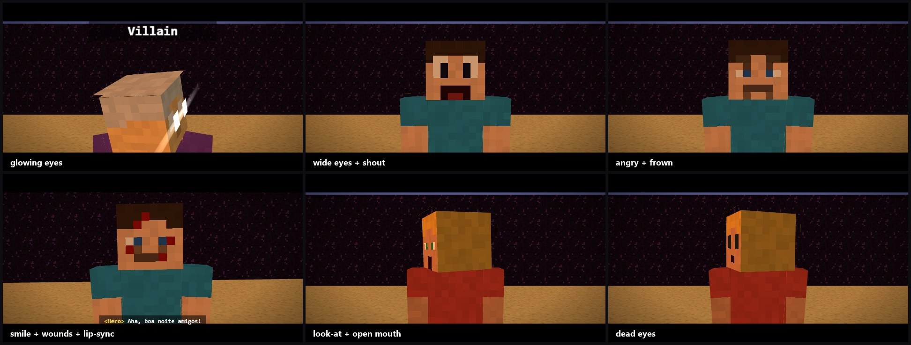
</details>

<details>
<summary><b>Câmeras e transições</b>: na mão, holandesa, zoom, primeira pessoa, órbita, troca de foco; flash, whip pan, fade; rampas de velocidade; 2.37:1</summary>

</details>

<details>
<summary><b>Partículas e ações no mundo</b>: quebra, explosão, fumaça, fogo, faíscas; rachaduras, TNT com pavio, crateras, portas, baús, água e lava</summary>
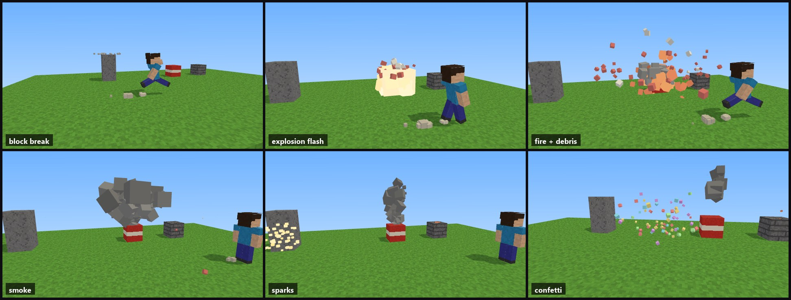
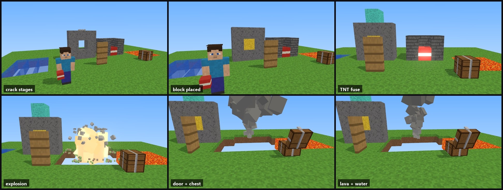
</details>

<details>
<summary><b>Visual</b>: luz de dia e noite, chuva e neve, bloom, profundidade de campo, grão, color grade</summary>

</details>

<details>
<summary><b>Comemorações e entregas</b>: fogos, totem, poções; thumbnails com título, vertical 9:16, GIF, SRT, motion blur</summary>
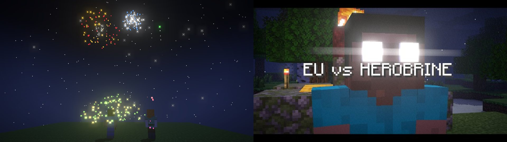
</details>

---

## 🧰 Três skills num plugin

| Skill | O que faz | Exemplo |
|---|---|---|
| **`blockreel`** | Filmes. Briefing → pesquisa (com links) → plano e decupagem → construção → **revisão visual obrigatória** → MP4 e entregas. | [`examples/`](examples) |
| **`blockreel-skins`** | Skins. Plano de paleta → pintura em camadas por código → validação → **turntable de 4 ângulos** para iterar. Classic e slim. Foto → skin persona. | [`examples/skin-demo`](examples/skin-demo) |
| **`blockreel-textures`** | Texturas de blocos e itens. Uma paleta → tiles que repetem sem emenda → **checador de emendas e paleta** → prévia em cena → `.zip` de resource pack. | [`examples/texture-pack-demo`](examples/texture-pack-demo) |

<table>
  <tr>
    <td width="50%">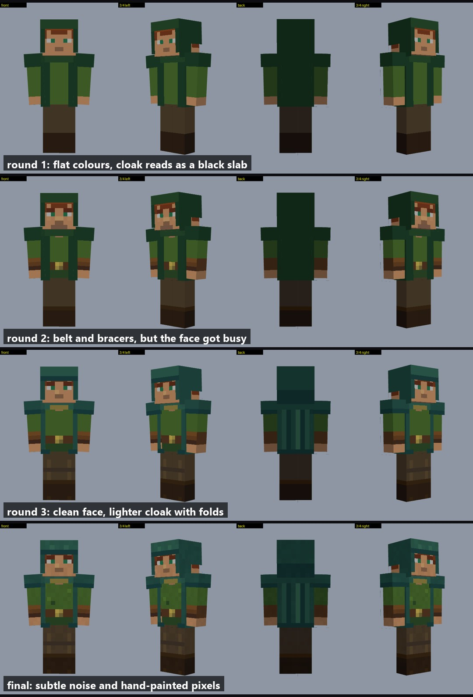<br><sub>Skins: quatro rodadas de revisão de uma skin de demonstração</sub></td>
    <td width="50%">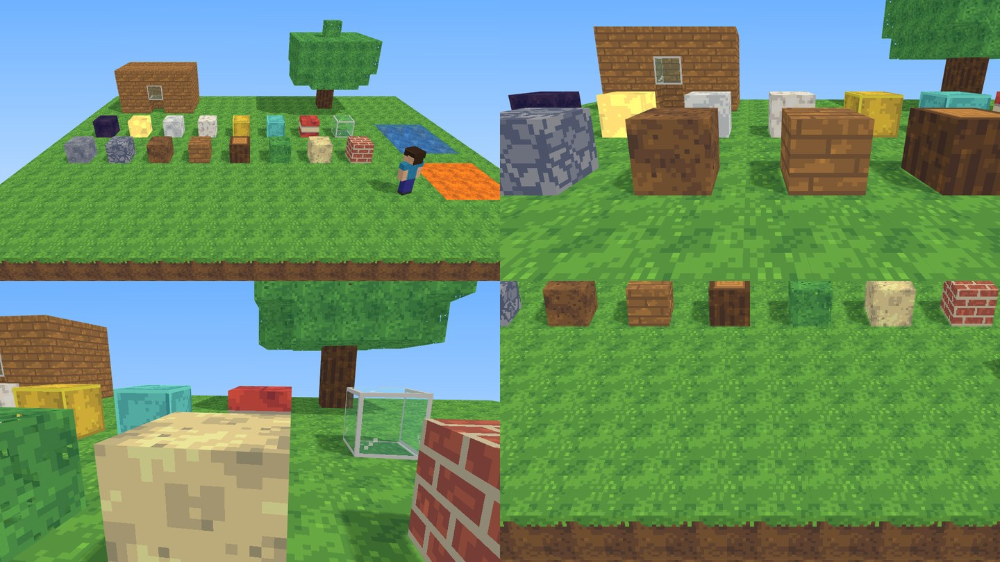<br><sub>Texturas: um pack CC0 de 25 texturas visto em cena, emendas checadas</sub></td>
  </tr>
</table>

---

## 🚀 Instalação

**Como plugin do Claude Code**

```bash
claude plugin marketplace add ViniciusNoetzold/mine-blockreel-skill-
claude plugin install blockreel@blockreel-market
```

**Ou clone e rode `claude` dentro da pasta**

```bash
git clone https://github.com/ViniciusNoetzold/mine-blockreel-skill- && cd mine-blockreel-skill-
npm install && pip install -r requirements.txt && python -m playwright install chromium
python tools/vanilla.py all       # opcional: texturas, mobs, animações, sons e fonte do jogo -> work/vanilla (local, nunca vai pro git)
python -m pytest tests -q         # 60 testes + checagens em node
```

Precisa de Node 20+, Python 3.11+, ffmpeg e Chrome/Chromium (`CHROME_PATH=...` também funciona). Não precisa de GPU.

## ⚡ Começo rápido

Peça ao Claude Code, em português ou inglês:

| Prompt | O que você recebe |
|---|---|
| *"Faz um vídeo de Minecraft de 30 s meu contra o Herobrine. Essa é a minha foto."* | uma skin persona a partir da foto, o filme do duelo, thumbnail e GIF |
| *"Dois amigos constroem uma casa e um creeper explode tudo."* | uma comédia com timelapse da construção e a explosão |
| *"Uma manhã tranquila numa vila: aldeões, filhotes, um passeio a cavalo, fogos no pôr do sol."* | algo como *Vila Viva* |
| *"Uma abertura de 8 s pro meu canal MEU CANAL, blocos de ouro, minha skin acenando."* | `tools/opening.py`: o nome em blocos, explosão, órbita, logo |
| *"Desenha uma skin de elfo com capuz pra mim, braços finos."* | uma skin com turntable de 4 ângulos |
| *"Faz um texture pack 16x em tons pastel."* | um conjunto que repete sem emenda, prévia e o zip do resource pack |

Mais prompts, incluindo um briefing completo de "super produção": [docs/PROMPTS.md](docs/PROMPTS.md).

Ou use as ferramentas direto:

```bash
python tools/compose.py examples/village-life/plan.json --out films/vila          # plano -> story.json, música, skins, decupagem
python tools/qa.py films/vila/story.json --out films/vila/qa                       # folha de contato + checagens automáticas
python tools/render.py films/vila/story.json --preset preview --workers 4 --out films/vila/preview.mp4
python tools/render.py films/vila/story.json --workers 4 --out films/vila/film.mp4
python tools/export.py gif films/vila/film.mp4 --start 4 --dur 6 --out vila.gif   # também: vertical, srt, thumbnail
python tools/preview.py examples/camera-lab/story.json                             # prévia ao vivo com barra de tempo
```

<details>
<summary><b>Todas as ferramentas</b></summary>

| Ferramenta | Função |
|---|---|
| `tools/compose.py` | o diretor: `plan.json` → `story.json` com marcação, cobertura, coreografia, sons e trilha |
| `tools/render.py` | `story.json` → MP4 (quadros soltos, preset de prévia, `--workers`, `--motion-blur`, `--size`, áudio) |
| `tools/qa.py` | quadros espalhados, folha de contato, checagem de trajetória a cada 0,05 s, enquadramento, legendas, ritmo |
| `tools/export.py` | GIF, vertical 9:16 re-renderizado, SRT, thumbnail com título |
| `tools/vanilla.py` | texturas, mobs (geometria, animações, filhotes, variantes), equipamentos, fonte e sons do jogo num cache local |
| `tools/score.py` | trilha original a partir de seções (calm, build, battle, silence, dawn) |
| `tools/voice.py` | vozes offline de personagens (Piper pt-BR, Windows OneCore) com presets |
| `tools/audio.py` | mixagem de música + efeitos + diálogo com ducking |
| `tools/opening.py` | abertura de canal no estilo YouTube a partir de um nome |
| `core/persona.py` | uma skin pintada a partir de uma foto descrita (cabelos, roupas, óculos, cores tiradas da foto) |
| `tools/turntable.py`, `core/skin.py` | prévia da skin em 4 ângulos; validar / converter / pintar skins que funcionam no jogo |
| `core/tilecheck.py`, `tools/pack_preview.py`, `core/pack.py` | checagem do conjunto de texturas, prévia em cena, zip do resource pack |
</details>

---

## 🏗️ Como funciona

```
plan.json ─► compose.py ─► story.json ─► motor Three.js no Chrome headless ─► quadros PNG ─► ffmpeg ─► film.mp4
                                │                    ▲                                                ▲
                                │       cache do jogo (work/vanilla) ou texturas CC0         trilha + efeitos + vozes
                                └─► qa.py: folha de contato + checagens
```

Cada quadro é função pura do tempo (`renderAt(t)`): um quadro solto bate exatamente com o vídeo final, prévias e renders em paralelo concordam quadro a
quadro, e um filme re-renderiza idêntico. Detalhes do motor: [TECHNIQUE.md](TECHNIQUE.md). Ofício de direção: [DIRECTOR.md](DIRECTOR.md).

| Documento | Para |
|---|---|
| [docs/DIRECTOR-PLAN.md](docs/DIRECTOR-PLAN.md) | o formato do plano e todos os beats |
| [docs/STORYBOARD.md](docs/STORYBOARD.md) | o schema completo do `story.json` |
| [docs/MOBS.md](docs/MOBS.md) | mobs, filhotes, variantes, animações |
| [docs/COVERAGE.md](docs/COVERAGE.md) | o que dá e o que ainda não dá para animar |
| [docs/PROMPTS.md](docs/PROMPTS.md) · [docs/GENRES.md](docs/GENRES.md) | prompts prontos, gêneros |
| [docs/QA.md](docs/QA.md) · [docs/PREPRODUCTION.md](docs/PREPRODUCTION.md) | regras de revisão e pré-produção |
| [docs/SKINS.md](docs/SKINS.md) · [docs/RESOURCE-PACKS.md](docs/RESOURCE-PACKS.md) | skins e texture packs |
| [docs/LEGAL.md](docs/LEGAL.md) | o que vem no repositório e o que é baixado |

## ⏱️ Desempenho (medido, renderização por software, sem GPU)

| Tarefa | Tempo |
|---|---|
| um quadro, incluindo abrir o navegador | ~3,5 s |
| filme de 30 s em 720p, 4 workers, 4 núcleos | ~10 min |
| mundo de 1,7 M blocos | 5 s para montar, 0,7 s por quadro em 720p |
| mundo de 4,4 M blocos | 13 s para montar, 0,6 s por quadro (a névoa corta os chunks distantes) |

## 🧱 Limites, com honestidade

O objetivo é *qualquer* animação de Minecraft; ainda não chegou lá. [docs/COVERAGE.md](docs/COVERAGE.md) é a lista do que falta:

- **Falta:** redstone (pistões, alavancas, lâmpadas), barcos, penhascos e saliências, multidões com instancing (centenas de atores), reflexos estilo shader, cinemática inversa e tecido.
- Lobo, urso polar e dragão usam regras de animação por nome de osso em vez dos scripts do jogo (os scripts deles movem um rig antigo).
- Skins e texture packs são validados e vistos no motor do BlockReel, não testados dentro do jogo.
- Renderização por software é lenta para filmes longos: conte minutos por 30 s.

## 🗺️ Próximos passos

- **Feito na v0.3:** animações dos mobs do jogo (Molang), filhotes e variantes, vilas, cavernas, portas, camas, placas, armaduras e élitro,
  montaria, natação e planar, fogos e totem, motion blur, exportação vertical, lip-sync pelo áudio, mundos enormes.
- **Próximo:** redstone, barcos, penhascos → multidões com instancing → render na GPU → uma interface web para quem não programa.

## ❓ Perguntas frequentes

<details><summary><b>Preciso ter o Minecraft instalado?</b></summary>
Não. Com o cache (<code>python tools/vanilla.py all</code>) o BlockReel baixa as texturas, modelos e sons do jogo das fontes públicas da Mojang
para a sua máquina; sem ele, usa as próprias texturas e rigs CC0.</details>

<details><summary><b>Usa modelo de vídeo de IA?</b></summary>
Não. O Claude escreve o plano e revisa os quadros; as imagens são desenhadas pelo Three.js e codificadas pelo ffmpeg. O resultado é
determinístico e editável: mude uma linha do plano e renderize de novo.</details>

<details><summary><b>Posso usar a minha skin, uma foto minha ou o meu texture pack?</b></summary>
Sim: um PNG de skin (<code>"skin": "eu.png"</code>), uma persona pintada a partir da sua foto (a skill lê a foto e tira as cores dela), e as suas
próprias texturas de bloco (<code>"textures"</code> / <code>"blocks"</code> no story, ou a skill <code>blockreel-textures</code>).</details>

<details><summary><b>Posso postar os vídeos no YouTube?</b></summary>
Leia as diretrizes de uso da Mojang e o <a href="docs/LEGAL.md">docs/LEGAL.md</a>. O BlockReel nunca redistribui arquivos do jogo; o que você renderiza com o seu cache local é responsabilidade sua.</details>

## 🤝 Contribuindo

Adicione um beat, uma animação, um ajuste de mob, um estilo ou uma correção de documentação. Rode `python -m pytest tests -q` (e
`node tests/world_check.mjs`, `node tests/geo_check.mjs`) antes. Nunca faça commit de arquivos do jogo.

Se o BlockReel fez um filme que você curtiu, uma ⭐ ajuda outras pessoas a encontrarem o projeto.

## 📄 Licença

MIT para código e documentação. Texturas embutidas, skins, texturas de exemplo de mobs e todos os assets dos exemplos: CC0. Minecraft é marca
registrada da Mojang Synergies AB; este projeto não tem vínculo com a Mojang ou a Microsoft.
